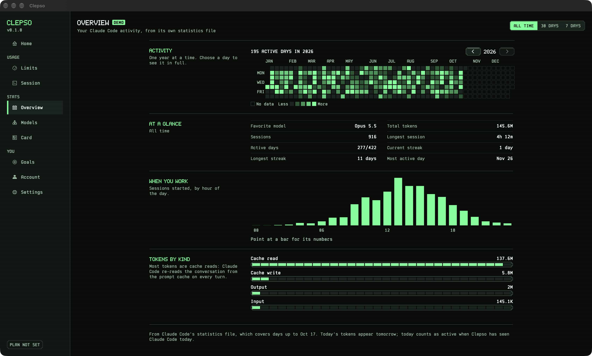
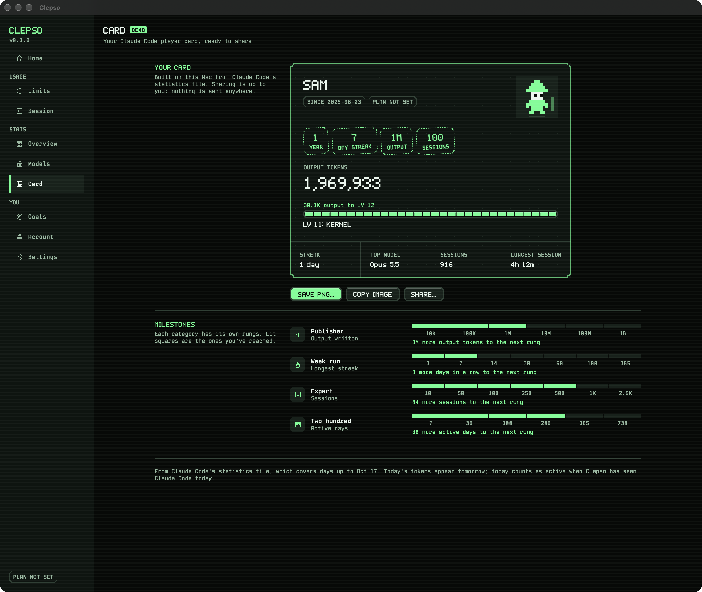
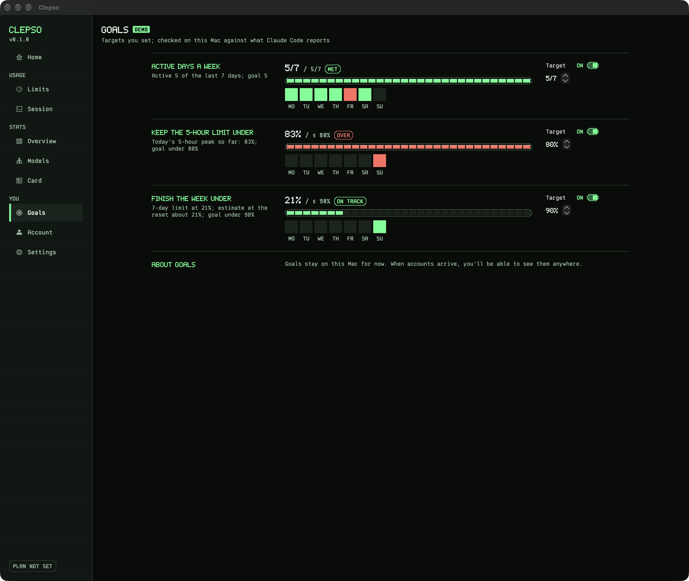
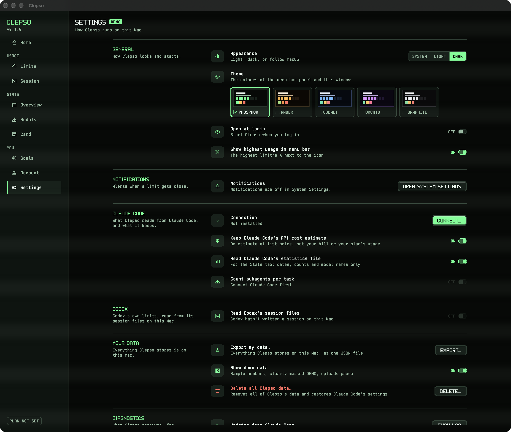
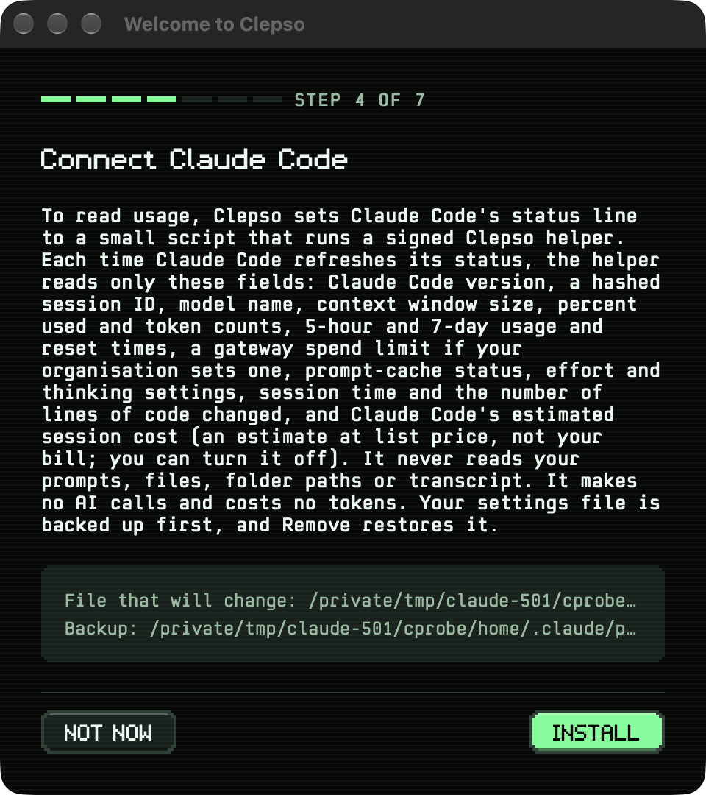
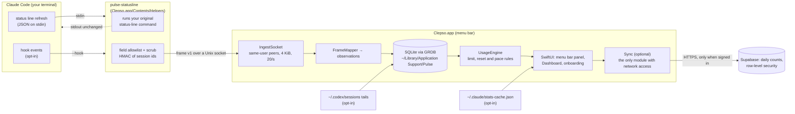

# Clepso

**A local-first macOS menu bar app that shows how much of your AI coding agent's usage limits you have left, and when they reset.**

Clepso is a working name. This repository is `tokone`; the app it builds is `Clepso.app`.

> **Status: pre-release (v0.1.0).** Clepso runs daily on its maintainer's Mac against real Claude Code sessions, but
> there are no signed builds and no releases yet. The source code is MIT-licensed (see [Licence](#licence)); the first
> public pre-release is planned as `v0.1.0-alpha`.


<sub>All screenshots show Clepso's built-in demo scenario (every screen is badged DEMO) with a synthetic statistics file and
the made-up profile name "Sam", rendered by the app itself (see [Run it safely](#run-it-safely)).</sub>

---

## Contents

- [Why Clepso exists](#why-pulse-exists)
- [What it does today](#what-it-does-today)
- [Screenshots](#screenshots)
- [Privacy model](#privacy-model)
- [How it works](#how-it-works)
- [Requirements](#requirements)
- [Build from source](#build-from-source)
- [Run it safely](#run-it-safely)
- [Quality gates (`make ci`)](#quality-gates-make-ci)
- [Project layout](#project-layout)
- [Optional accounts backend](#optional-accounts-backend)
- [Project status and roadmap](#project-status-and-roadmap)
- [Known limitations](#known-limitations)
- [Troubleshooting](#troubleshooting)
- [Contributing, security and conduct](#contributing-security-and-conduct)
- [Licence](#licence)
- [Acknowledgements](#acknowledgements)

---

## Why Clepso exists

Subscription plans for AI coding agents meter usage in rolling windows (for Claude Code: a 5-hour window and a
7-day window). Hitting a limit mid-task is disruptive, and the built-in view is a command you have to remember to
run. Clepso keeps the numbers in the menu bar, says how fresh they are, estimates where your current pace is heading,
and keeps a local history, without sending your prompts, code or file paths anywhere.

Clepso reports only what the agent itself reports. When a value is missing it says so instead of showing "0%", and it
never guesses your plan from your usage.

## What it does today

Everything below exists in the code on `main`. Items marked *opt-in* stay off until you turn them on.

**Menu bar**
- A pixel-style menu bar mark for the most pressing limit. Its states (for example available, approaching,
  exhausted, not connected) differ by shape as well as colour.
- A panel with the 5-hour and 7-day limits: used %, status in words, reset time and countdown, freshness
  ("just now", stale), and a labelled *estimate* of when the current pace reaches 100%.
- The current session: model, context used, cost estimate, prompt-cache hit rate, lines added/removed, API time,
  and how many agents the last task used.
- Codex's 5-hour and weekly limits beside Claude Code's (*opt-in*).

**Dashboard window**
- **Home**: what needs attention now (limits, goals, a running task), both limits, the last 30 days, your level.
- **Limits**: each limit charted over its own window, with 80/95% bands, "now", and the dashed pace estimate
  (Claude Code's, and Codex's when that is on).
- **Session**: recent sessions, the selected session's details, agents per task, usage by model.
- **Overview** and **Models**: a year activity calendar, tokens per day, streaks, model shares, and a "model arena"
  with levels earned from output tokens (*opt-in*: reads Claude Code's statistics file).
- **Card**: a shareable pixel "player card" (copy image, save PNG, share). Nothing is sent unless you share it.
- **Goals**: active days per week, keep the 5-hour peak under a target, finish the week under a target; streaks.
- **Account**: profile name, chosen plan, optional sign-in (see [Optional accounts backend](#optional-accounts-backend)).
- **Settings**: appearance (System / Light / Dark) and colour theme (Phosphor, Amber, Cobalt, Orchid, Graphite; each
  with light and dark palettes), launch at login, notification permission and a test notification, the Claude Code
  connection (connect / remove), opt-ins (statistics file, agents per task, Codex), export, demo data, diagnostics
  log, delete all.

The interface is set in Clepso's own pixel typefaces, Clepso Pixel and Clepso Mono, and the app has its own icon.

**Data controls**
- **Export my data**: a JSON file (permissions 0600) of the local tables, with every string re-checked by the same
  scrubber the helper uses.
- **Delete all**: removes Clepso's database and its files under `~/.claude/pulse`, and restores your Claude Code
  settings; optionally also deletes the settings backups.
- **Retention**: limit readings and engine events are kept 90 days; sessions, agent tasks and notification receipts 30 days.
- **Demo mode**: a fixed scenario run through the real engine and store, so you can explore without connecting anything.

**Sources Clepso can read**

| Source | What Clepso reads | Default |
|---|---|---|
| Claude Code status line | An allowlisted subset of the JSON Claude Code sends to its status-line command: limits, model, context, token and cache counts, durations, line counts, and the cost estimate (which you can switch off) | On once you connect it in onboarding or Settings |
| Claude Code hooks | For `UserPromptSubmit`, `SubagentStart`, `SubagentStop` and `Stop`: the event name, keyed hashes of the session and agent ids, and the built-in agent type ("custom" otherwise) | Off (*opt-in*; shows the exact entry before writing it) |
| `~/.claude/stats-cache.json` | Dates, counts, model ids and token totals through a field allowlist; never stored, logged or exported | Off (*opt-in*) |
| `~/.codex/sessions/**/rollout-*.jsonl` | Only `token_count` events (5-hour and weekly used %, reset, plan) and the model name, from the last 256 KB of the three newest files; other lines are skipped before decoding | Off (*opt-in* in Settings) |

## Screenshots

| | |
|---|---|
|  |  |
| **Home** | **Limits** |
|  |  |
| **Overview** | **Models (arena)** |
|  |  |
| **Card** | **Goals** |
|  |  |
| **Session** | **Settings** |
|  |  |
| **Light mode** | **Onboarding consent** |

More in [`design/screens/`](design/screens/). The images are captured by the app's debug probe (see
[Run it safely](#run-it-safely)).

## Privacy model

Clepso is built so that the part Claude Code runs cannot leak what it sees, and so that every change it makes to your
machine can be undone.

- **Allowlist, not blocklist.** The helper copies only named fields, each with a type and range check
  ([`Sources/ShimProtocol/Allowlist.swift`](Sources/ShimProtocol/Allowlist.swift)). Your working directory,
  transcript path, session name, prompt id and workspace folders are never forwarded. Strings that look like paths,
  emails or secrets are dropped. Session ids are replaced by an HMAC keyed with a random 32-byte key stored at
  `~/.claude/pulse/session.key` (0600).
- **The helper cannot reach the network.** `pulse-statusline` links only Foundation, CryptoKit and system libraries;
  `make ci` fails if it links any networking library or symbol.
- **Network code lives in one module.** Only `Sources/Sync` may use networking APIs, and only the app imports it
  (`make ci` enforces both). Sync does nothing unless the build carries an accounts project *and* you sign in.
  **Builds from source carry none**, so they never sign in or upload anything (see
  [Optional accounts backend](#optional-accounts-backend)).
- **Your Claude Code settings are changed reversibly.** Connecting changes exactly one key, `statusLine.command`,
  in `~/.claude/settings.json`, after writing a byte-exact backup to `~/.claude/pulse-backups/`. Writes are
  compare-and-swap with an atomic rename, and an interrupted install can be recovered. If you already had a status
  line, it keeps running and its output reaches Claude Code unchanged. Removing Clepso restores the original bytes.
- **Local IPC is restricted to your user.** The app listens on a Unix socket at
  `~/Library/Application Support/Pulse/run/agent.sock` (folder 0700, socket 0600), accepts only peers running as
  your user id, frames of at most 4 KiB, and at most 20 frames per second.
- **Logs are redacted by type.** Values wrapped in `Redacted<T>` cannot be encoded; `make ci` audits every place that
  unwraps one.
- **If you sign in** (optional, official builds), Clepso uploads once an hour: your profile name and plan label, and per-day counts
  (messages, sessions, active day, tokens per model, model totals by token kind, 5-hour peak and 7-day end %, agents
  per task by built-in type, goal targets and results). No prompts, replies, paths, project names or raw ids. Every
  table is protected by row-level security, and deleting your account deletes every row
  ([`backend/supabase/migrations/`](backend/supabase/migrations/)).

What Clepso does **not** do: read your prompts or replies, read transcripts, or send anything anywhere unless you sign in.
The full design is in [`docs/PRIVACY_AND_SECURITY.md`](docs/PRIVACY_AND_SECURITY.md).

## How it works



1. Claude Code runs its status-line command on every refresh and pipes a JSON description of the session to it.
   Connecting Clepso points that command at a small wrapper script (`~/.claude/pulse/statusline.sh`) that runs the
   helper embedded in the app bundle, or your original command if the app has been removed.
2. The helper starts your original status-line command (if any) with the exact input bytes, so your status line looks
   the same. Meanwhile it builds an allowlisted *frame* and sends it to the app over a Unix socket within a fixed time
   budget (connect within 20 ms, everything finished by about 48 ms after start). It never writes to disk and never
   retries; if the app is not running, the frame is dropped.
3. The app validates the frame, maps it to typed observations with their provenance, and stores a reading when a
   value changes (otherwise a check-in every 2 minutes).
4. Pure state machines in `UsageEngine` derive each limit's state (available, approaching, critical, exhausted,
   reset expected, available again) with hysteresis, and a least-squares pace estimate over recent readings.
5. The SwiftUI layer reads a projection of that state. Colours, spacing and type come only from the `Theme` tokens in
   `DesignSystem`, and icons are pixel glyphs (both enforced by `make ci`).

Clepso is a menu bar-only app (`LSUIElement`). It is not sandboxed, because it has to read and edit files under
`~/.claude`; it has no entitlements beyond the debug-only `get-task-allow`, and official builds use hardened runtime.
More: [`docs/ARCHITECTURE.md`](docs/ARCHITECTURE.md) and [`docs/DATA_MODEL.md`](docs/DATA_MODEL.md).

## Requirements

| | Version | Notes |
|---|---|---|
| macOS | 14 Sonoma or later (deployment target) | Development runs on a current macOS release |
| Xcode | 27.1 (pinned by `make ci`; `make ci-contributor` accepts any Swift 6 toolchain) | Provides the macOS SDK and `xcodebuild` |
| Swift | 6.4 (bundled with Xcode 27.1) | Swift 6 language mode; warnings are errors |
| XcodeGen | 2.46.0 | Downloaded and SHA-256-checked into `.tools/` by `scripts/bootstrap.sh`; no Homebrew needed |
| Claude Code | A version with status-line support | The fixtures were captured from 2.1.302 |
| Docker and the Supabase CLI | Optional | Only for `make backend-test` |
| Python 3 | Optional | Only for the documentation site and the fixture oracle |

The only third-party Swift package is [GRDB.swift](https://github.com/groue/GRDB.swift) 7.11.1, pinned by revision
in `Package.resolved`.

## Build from source

```sh
git clone https://github.com/obileonardo/tokone.git
cd tokone
sudo xcode-select -s /Applications/Xcode.app   # point at your Xcode 27.1 installation

swift build        # all libraries and command-line tools
swift test         # the full suite: no network, never touches your real ~/.claude
make app           # Clepso.app: XcodeGen → xcodebuild → codesign --verify
```

`make app` writes `build/DerivedData/Build/Products/Debug/Clepso.app`. The Xcode project (`Pulse.xcodeproj`) is
generated from `project.yml` and is not committed; `Package.swift` is the source of truth for all code.

**Local configuration** (all optional; the files are gitignored, each has a committed `.example` template in
`Config/`):

| File | What it sets | Without it |
|---|---|---|
| `Config/Signing.local.xcconfig` | Your signing identity and team | The app is signed ad hoc, which is enough to run it on the Mac that built it |
| `Config/Sync.local.xcconfig` | An accounts project (host and publishable key) | Sync is off: no sign-in, no uploads, no requests |
| `Config/local.mk` | `DOCS`, the planning folder `make site` reads | `make site` stops with an explanation |

`Config/Pulse.xcconfig` holds the defaults and includes the local files when they exist.

| Command | What it does |
|---|---|
| `make ci` | Every quality gate, strict (see below). Logs in `.build/ci-logs/` |
| `make ci-contributor` | The same gates for machines without the maintainer's setup: any Swift 6 toolchain, ad-hoc signing, Sync off |
| `make build` | `swift build --build-tests -Xswiftc -warnings-as-errors` |
| `make test` | `swift test` |
| `make perf` | Helper overhead budget: release build, 200 runs, p95 ≤ 20 ms (enforced on the maintainer's Mac; hosted runners are too noisy for absolute budgets) |
| `make backend-test` | Starts a local Supabase stack (Docker) and runs the pgTAP row-level-security tests |
| `make site` | Regenerates the documentation website in `site/` (needs `DOCS` in `Config/local.mk`: planning documents that are not in this repository) |

## Run it safely

Debug builds accept two launch arguments that redirect everything Clepso reads and writes, so you can try it without
touching your real `~/.claude` or Application Support folder:

```sh
build/DerivedData/Build/Products/Debug/Clepso.app/Contents/MacOS/Clepso \
    -PulseDataDirectory /tmp/pulse-data -PulseHome /tmp/pulse-home
```

With `-PulseDataDirectory` set, sign-in state is kept in memory instead of the Keychain, so a debug run can never
upload to, or sign out of, a real account. Choose **Show demo data instead** in onboarding to see the screens above.
Keep the data folder path short: the socket path inside it must stay under the 104-byte Unix limit, otherwise the
panel reports that it isn't receiving updates.

To connect a real Claude Code, launch normally and use **Connect** in onboarding or the Claude Code connection in
**Settings**. Clepso shows the exact change to `settings.json` before writing anything. The headless CLI does the same
and only previews unless you pass `--confirm`:

```sh
swift run pulse install --shim <path to pulse-statusline>           # preview only
swift run pulse install --shim <path to pulse-statusline> --confirm # install
swift run pulse status
swift run pulse uninstall --confirm                                 # restore your settings
swift run pulse recover                                             # finish or roll back an interrupted install
```

**Screenshots and popover timing** (debug builds):

```sh
python3 -I scripts/probe-home.py /tmp/pulse-home                 # synthetic ~/.claude/stats-cache.json, fixed seed
build/DerivedData/Build/Products/Debug/Clepso.app/Contents/MacOS/Clepso \
    -PulseDataDirectory /tmp/pulse-data -PulseHome /tmp/pulse-home \
    -PulseProbeOutput /tmp/pulse-shots -PulseProbeDemo YES &       # add -PulseProbeLight YES for light mode
swift scripts/probe-popover.swift /tmp/pulse-shots 40
```

The script posts 40 real clicks on the status item (your terminal needs Accessibility permission) and prints
popover-open p50/p95; the app then saves each screen as a PNG in the output folder and quits. The probe always uses
the profile name "Sam" (or `-PulseProbeName <name>`), never your Mac account's name.

## Quality gates (`make ci`)

`scripts/ci.sh` runs every check even if an earlier one fails, prints a summary, and exits non-zero if any failed.
`make ci` is strict: it pins the toolchain and requires the app to be signed with a real identity, with hardened
runtime, and with an accounts project configured, so an official build cannot quietly fall back. `make ci-contributor`
(`scripts/ci.sh --contributor`) runs the same checks but accepts any Swift 6 toolchain, an ad-hoc signature and no
accounts project.

| Gate | What it proves |
|---|---|
| toolchain pinned | Xcode 27.1 and Swift 6.4 are selected (contributor mode: a Swift 6 toolchain) |
| strict build | Everything, tests included, builds with warnings as errors |
| tests | `swift test` passes |
| helper links no networking | The release `pulse-statusline` links only allowed system libraries and no networking symbols |
| networking only in Sync | No `URLSession`/`Network` use outside `Sources/Sync`; only the app imports `Sync` |
| clock injected | No direct `Date()` in the pure layers and the app (time is injected) |
| design tokens only | Components and screens use `Theme` tokens and pixel icons, never raw colours, sizes or system symbols |
| redaction audit | `unsafeReveal` only in `Storage` and the helper; `Redacted` is never `Codable` |
| secret scan | No secret-shaped strings in the tree (a regex stand-in for a full scanner) |
| no committed accounts project | No Supabase project host or publishable key in tracked files, and no `Config/*.local.xcconfig` tracked |
| app bundle | `Clepso.app` builds and is signed, embeds the helper under its identifier, has no unexpected entitlements, runs as a menu bar app, registers the sign-in URL scheme, ships the third-party licences, and its helper links no networking. Strict mode also requires a real signature, hardened runtime and a configured accounts project |

There is no hosted CI yet. A proposed GitHub Actions workflow is in
[`docs/open-source/proposed/ci.yml`](docs/open-source/proposed/ci.yml); it is not active.

## Project layout

```
App/PulseMac/              @main, app icon and Acknowledgements.txt (Info.plist and entitlements are generated)
Config/                    Pulse.xcconfig defaults and templates for the uncommitted local settings
Sources/
  Domain/                  Value types, provenance, Redacted<T>. No I/O, no clock reads
  ShimProtocol/            Frame v1, the field allowlist, the string scrubber, hook frames
  StatusLineShim/          The helper's run loop: stdin, child process, socket send
  pulse-statusline/        The helper executable Claude Code runs (one-line main)
  ClaudeCodeAdapter/       Settings and hooks installers, ingest socket, frame mapper, statistics reader
  CodexAdapter/            Codex session-file tail reader
  UsageEngine/             Pure limit, reset, session and pace state machines
  Storage/                 GRDB/SQLite schema v1–v3, migrations, ledger policy, retention
  SubscriptionCatalog/     Bundled plan catalog (plan-catalog.v1.json)
  DesignSystem/            Themes and tokens, status styles, pixel components and glyphs, bundled fonts
  PulseApp/                Composition root, AppModel, projections, SwiftUI views, copy, diagnostics, export
  Sync/                    Optional accounts: PKCE email-link sign-in, Keychain session, upload
  pulse/                   Headless CLI: install, uninstall, status, recover
  FixtureTools/, pulse-fixture/   Developer-only capture listener and scrubber (never shipped)
  pulse-design-render/     Developer-only: renders real components to PNG for the design-system page
  TestFixtures/            Fixture corpus F01–F19 and one scrubbed real capture (C01)
Tests/                     Swift Testing suites per module, plus integration tests that run the built helper
backend/supabase/          Accounts schema with row-level security, pgTAP tests, local Supabase config
design/screens/            App screenshots (demo data, synthetic statistics)
design/brand/              The Clepso mark, app icon, typefaces and their build pipeline
docs/                      Architecture, data model, privacy and security, fixtures, open-source readiness
scripts/                   ci.sh, bootstrap.sh, site generators, fixture oracle, probe driver and synthetic home
site/                      Generated documentation website (static HTML)
```

## Optional accounts backend

`backend/supabase` holds the schema for optional Clepso accounts: eight tables of daily counts keyed by the signed-in
user, each with forced row-level security (`user_id = auth.uid()`), no grants to anonymous users, and a
`delete_account()` function whose deletion cascades to every row. `make backend-test` runs 16 pgTAP checks against
a local stack.

The app's Sync client signs in with a one-time email link using PKCE, returns to the app through the
`dev.tokone.pulse://auth-callback` URL scheme, keeps the session in the Keychain (this device only), and uploads
idempotently once an hour. Apple, Google and GitHub sign-in are shown as "Soon" and are not enabled. The web
dashboard is not built yet.

**No accounts project is compiled in.** The app reads one from its Info.plist, which gets it from
`Config/Sync.local.xcconfig` at build time. A build from source has none: the Account page says accounts aren't
available in this build, Home never suggests signing in, and Clepso makes no network request at all. To use your own
backend, apply `backend/supabase/migrations/` to your Supabase project and copy `Config/Sync.local.xcconfig.example`
with your project's host and **publishable** key (the app refuses secret keys).

## Project status and roadmap

| Milestone | State |
|---|---|
| M0 Foundation: domain, helper, fixtures, reversible installer, local CI, first real capture | Done |
| M1 Mac vertical slice: socket, engine, store, design system, menu bar app, diagnostics, export, delete all, details and stats, dashboard, pixel UI, light mode | Done |
| 1.9 Agents per task through Claude Code hooks | Done (opt-in) |
| 2.0 Accounts: schema with row-level security and Mac sign-in and upload (done); web dashboard | In progress |
| 3.4 Codex limits: reader, store, panel, Limits page and Settings switch | Done (opt-in) |
| 1.15–1.16 Five colour themes; Clepso's own typefaces, app icon and menu bar mark | Done |
| M2 Limit notifications, reset reminders, time-travel test harness | Planned (today: permission and a test notification only) |
| M3 More providers (manual snapshots, Gemini) | Planned |
| M4 Signing and notarization; iPhone, Watch and widgets | Planned |

The bundled plan catalog lists Claude, ChatGPT, Gemini and Grok plans with source links; Claude Code and Codex limits
are read automatically today.

## Known limitations

- Claude Code's status line carries only the 5-hour and 7-day limits. Per-model weekly limits that `/usage` shows are
  not visible to Clepso; it says so and counts the limit windows it cannot read.
- Readings arrive only while Claude Code refreshes its status line, so Clepso shows how old each value is.
- Clepso always uses `~/.claude`. A custom `CLAUDE_CONFIG_DIR` is supported by the installer code but not yet wired
  into the app.
- Limit notifications are not implemented yet.
- No signed or notarized builds and no auto-update; only Apple silicon has been tested.
- `make site` reads planning documents that are not in this repository.
- The local socket accepts any process running as your user; a code-signature check of the helper is planned
  ([`docs/PRIVACY_AND_SECURITY.md`](docs/PRIVACY_AND_SECURITY.md) §3).

## Troubleshooting

| Symptom | What to check |
|---|---|
| `make ci` fails at "toolchain pinned" or "app bundle" | That is the strict mode. Use `make ci-contributor` unless you build official releases |
| `make app` fails with a signing error | Remove or fix `Config/Signing.local.xcconfig`; without it the app is signed ad hoc |
| The panel says Clepso isn't receiving updates (debug run) | The `-PulseDataDirectory` path is too long for a Unix socket; use a shorter one |
| Account says accounts aren't available | Expected in builds from source (see [Optional accounts backend](#optional-accounts-backend)) |
| The panel says "not connected" | Claude Code only runs the status line while a session is open; check Settings for the connection state and the diagnostics log |
| My old status line disappeared | It should keep running. Run `swift run pulse status`, then `swift run pulse uninstall --confirm` to restore the backed-up bytes, and open an issue |
| Want to see what Clepso stored | Settings › Export my data writes a JSON copy |

## Contributing, security and conduct

- How to propose changes, run the gates and write tests: [`CONTRIBUTING.md`](CONTRIBUTING.md)
- Reporting a vulnerability privately: [`SECURITY.md`](SECURITY.md)
- Community standards: [`CODE_OF_CONDUCT.md`](CODE_OF_CONDUCT.md)

## Licence

The source code is released under the [MIT License](LICENSE), copyright (c) 2026 Elvis Obi. Third-party components keep
their own licences, listed in [`THIRD_PARTY_NOTICES.md`](THIRD_PARTY_NOTICES.md) and shipped inside the app in
`Acknowledgements.txt`. The Clepso name, logo, app icon and the Clepso Pixel and Clepso Mono typefaces are brand assets;
their terms are described in `THIRD_PARTY_NOTICES.md`.

Claude and Claude Code are trademarks of Anthropic; Codex and ChatGPT of OpenAI; Gemini of Google; other product
names belong to their owners. Clepso is an independent project, not affiliated with or endorsed by any of them; the
names are used only to say which tools Clepso works with.

## Acknowledgements

- [GRDB.swift](https://github.com/groue/GRDB.swift) by Gwendal Roué (MIT), for SQLite.
- [Silkscreen](https://github.com/googlefonts/silkscreen), [Pixelify Sans](https://github.com/eifetx/Pixelify-Sans)
  and VT323 (SIL Open Font License 1.1), for the pixel type.
- [three.js](https://threejs.org) r160 (MIT), for the documentation site's footer scene.
