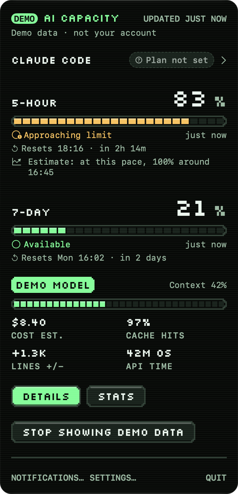
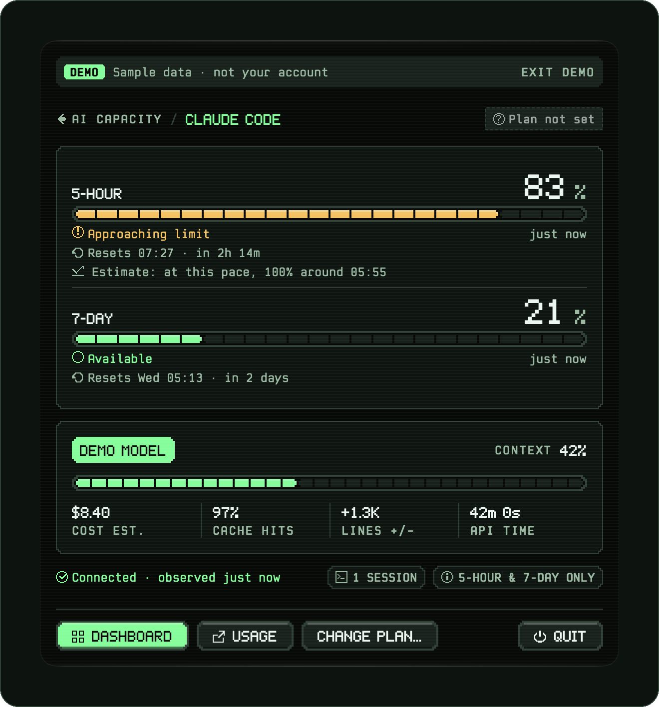
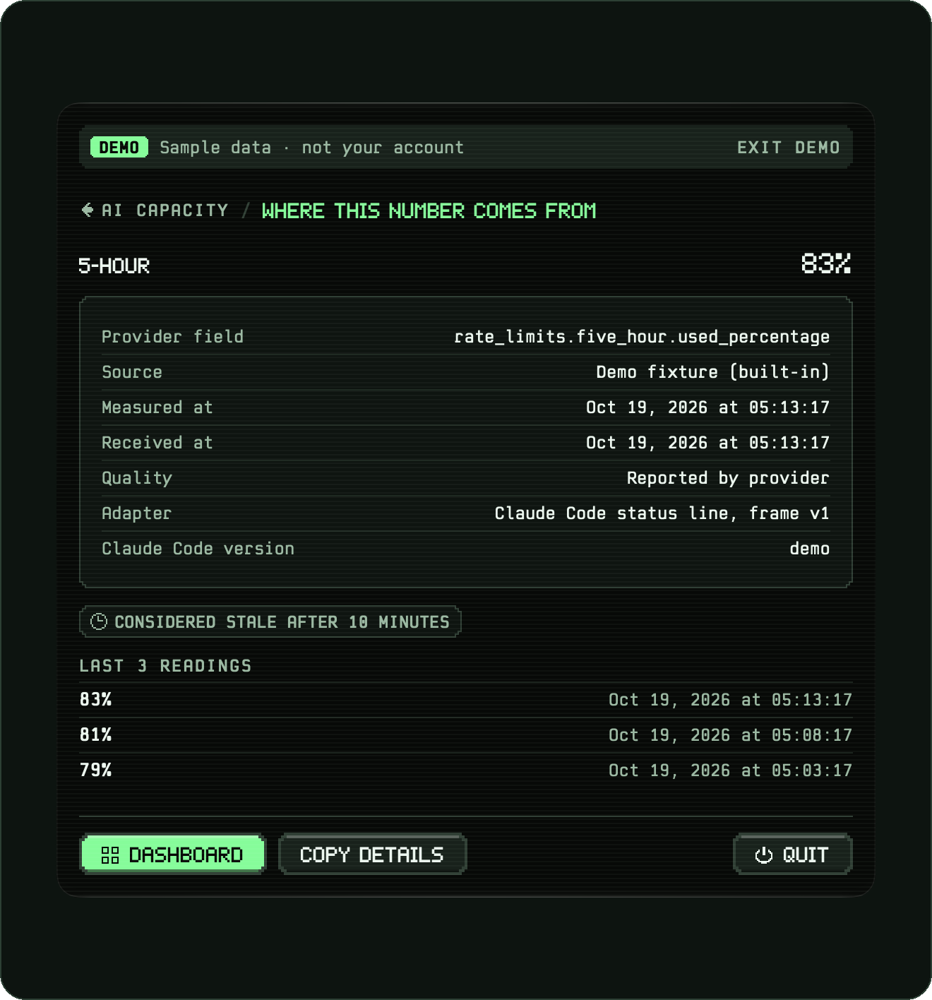
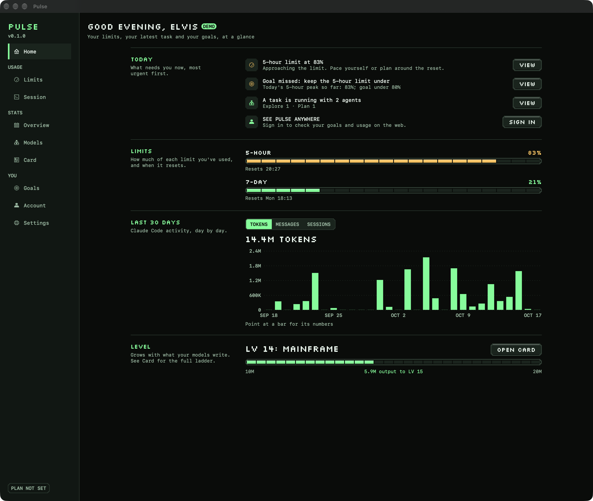
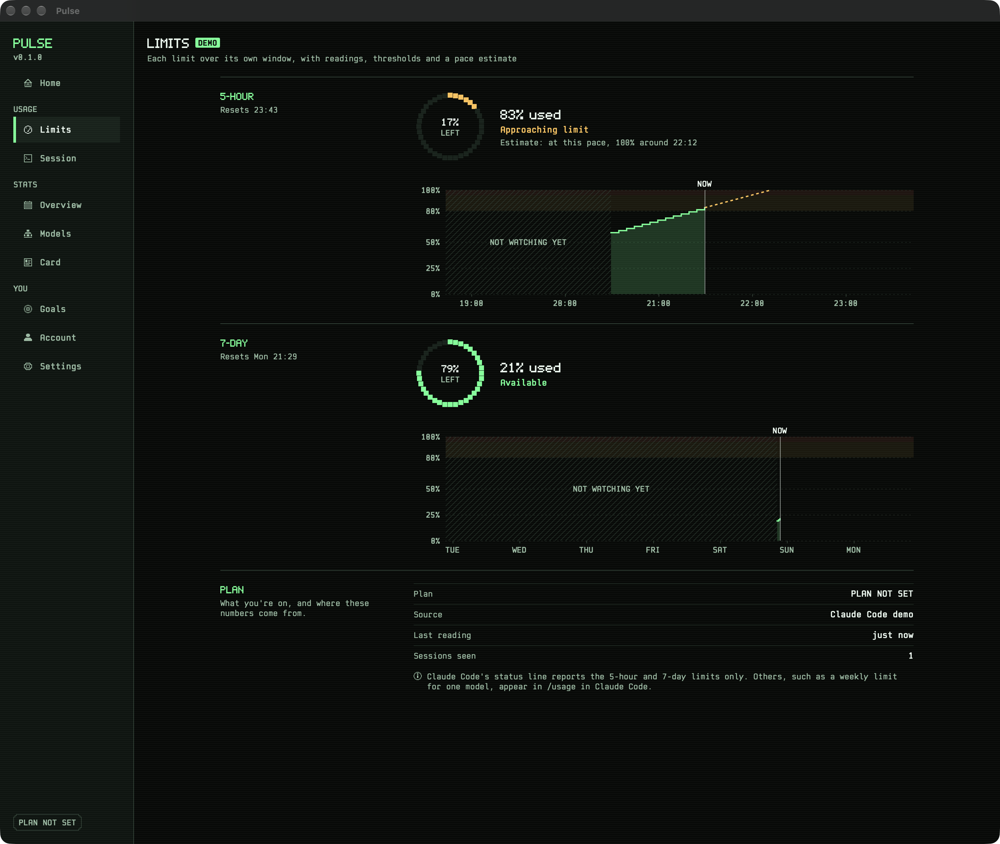
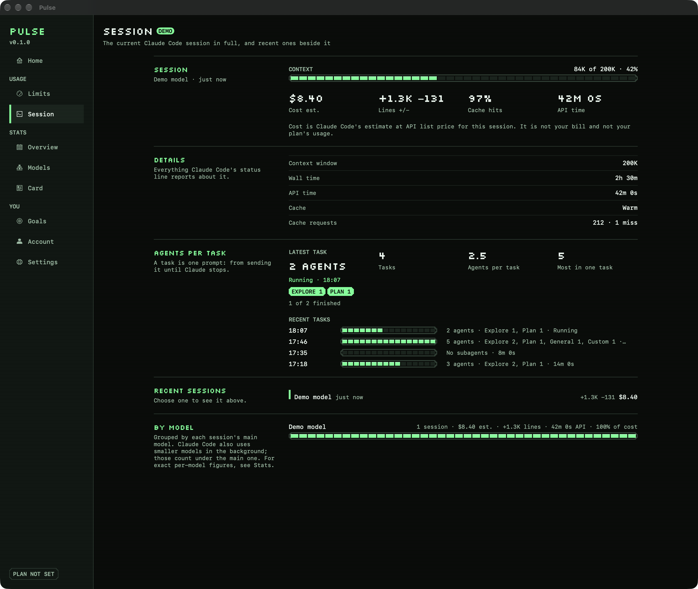
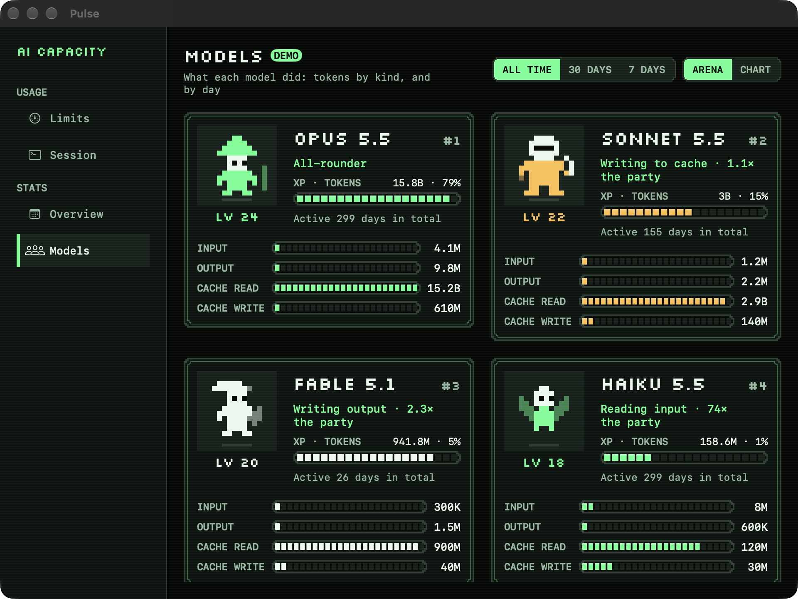
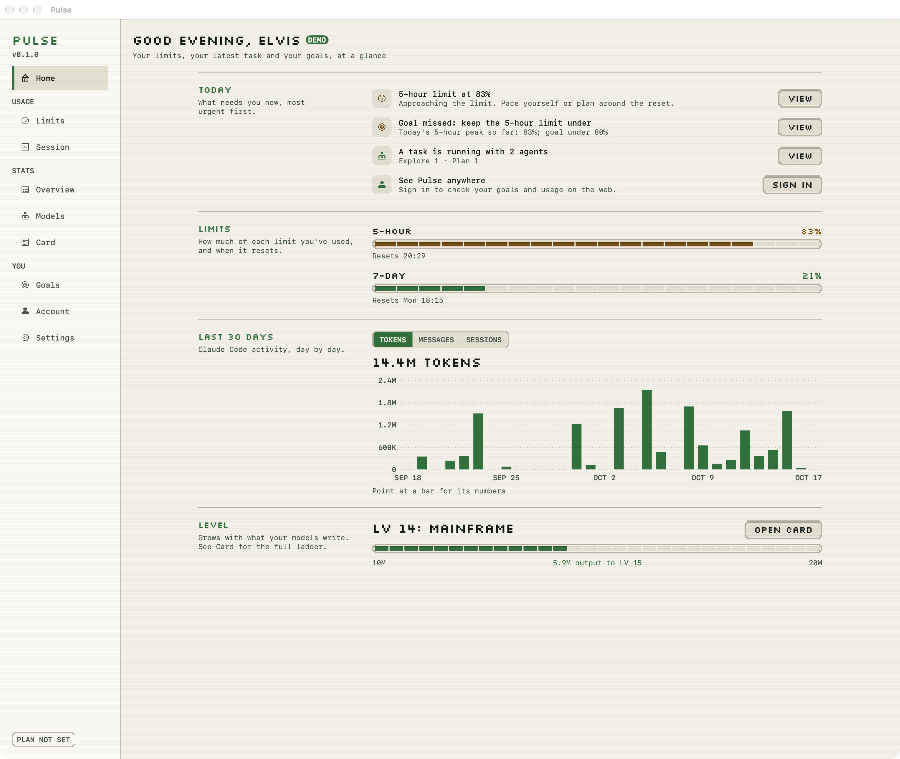
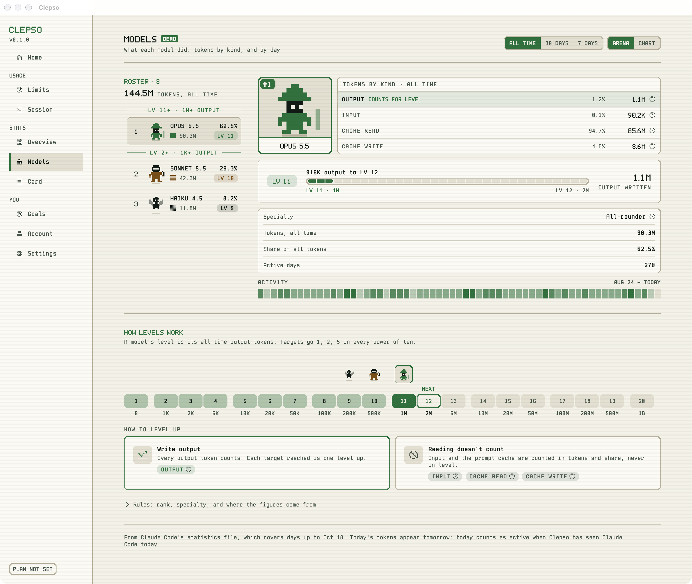
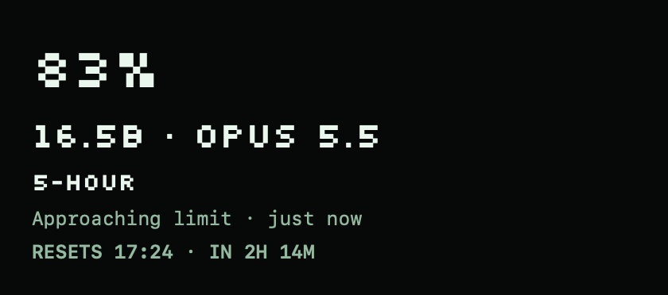

<p align="center">
  <picture>
    <source media="(prefers-color-scheme: dark)" srcset="design/brand/logo/svg/clepso-horizontal-phosphor.svg">
    <source media="(prefers-color-scheme: light)" srcset="design/brand/logo/svg/clepso-horizontal-deep.svg">
    
  </picture>
</p>

<p align="center">
  <b>Your coding-agent limits, before you hit them.</b><br>
  A local-first macOS menu bar app that shows how much of your Claude Code and Codex<br>
  usage limits you have used, when they reset and how fast you are going,<br>
  from what those agents report on your own Mac.
</p>

<p align="center">
  <a href="https://github.com/obileonardo/clepso/actions/workflows/ci.yml"></a>
  <a href="https://github.com/obileonardo/clepso/releases"></a>
  <a href="LICENSE"></a>
  
  
  
</p>

<p align="center">
  <a href="https://github.com/obileonardo/clepso/releases/tag/v0.1.0-alpha.1"><b>Download</b></a> ·
  <a href="https://clepso-app.vercel.app"><b>Website</b></a> ·
  <a href="#docs"><b>Docs</b></a> ·
  <a href="https://clepso-app.vercel.app/privacy/"><b>Privacy</b></a> ·
  <a href="https://clepso-app.vercel.app/design-system/"><b>Design system</b></a> ·
  <a href="https://clepso-app.vercel.app/progress/"><b>Progress</b></a> ·
  <a href="https://clepso-app.vercel.app/changelog/"><b>Changelog</b></a>
</p>

<p align="center">
  
</p>

<p align="center"><sub>Every screenshot shows Clepso's built-in demo scenario (each screen is badged DEMO) with a synthetic
statistics file and the made-up profile name "Sam", rendered by the app itself (see <a href="#run-it-safely">Run it safely</a>).</sub></p>

---

> [!NOTE]
> **Alpha: [v0.1.0-alpha.1](https://github.com/obileonardo/clepso/releases/tag/v0.1.0-alpha.1) is out.** A signed, notarized build for Macs with Apple silicon on macOS 14 or
> later ([download](#download)). It is an early pre-release: expect rough edges, and a new alpha every two weeks. You can
> also [build it from source](#build-from-source).
> This repository (`clepso`, formerly `tokone`) builds `Clepso.app`.

## Why Clepso

Subscription plans for AI coding agents meter usage in rolling windows (for Claude Code: a 5-hour window and a
7-day window). Hitting a limit mid-task is disruptive, and the built-in view is a command you have to remember to
run. Clepso keeps the numbers in the menu bar, says how fresh they are, estimates where your current pace is heading,
warns you before a limit runs out, and keeps a local history, without sending your prompts, code or file paths
anywhere.

Clepso reports only what the agent itself reports. When a value is missing it says so instead of showing "0%", and it
never guesses your plan from your usage.

## What it does

Everything below exists in the code on `main`. Items marked *opt-in* stay off until you turn them on.

### In the menu bar

- A pixel menu bar mark for the most pressing limit, across Claude Code and Codex. Its states (live, approaching,
  limit reached, stale, demo, waiting, not connected) differ by shape as well as colour (see [Design system](#design-system)).
- A panel with the 5-hour and 7-day limits: used %, status in words, reset time and countdown, freshness
  ("just now", stale), and a labelled *estimate* of when the current pace reaches 100%.
- The current session: model, context used, cost estimate, prompt-cache hit rate, lines added/removed, API time,
  and how many agents the last task used.
- Codex's 5-hour and weekly limits beside Claude Code's (*opt-in*).

<table>
  <tr>
    <td align="center" valign="top" width="50%">
      
      <p><b>Claude Code</b><br><sub>Both limits with the pace estimate, the current session and how fresh the connection is.</sub></p>
    </td>
    <td align="center" valign="top" width="50%">
      
      <p><b>Where this number comes from</b><br><sub>The field, source, times and quality behind a reading, and the readings before it.</sub></p>
    </td>
  </tr>
</table>

### Alerts before you hit a limit

- Notifications at 80%, 95% and 100% of a limit, when a reset is expected, and when a limit is ready again; on once
  you allow notifications, with a one-hour snooze. Alerts too old to be news are dropped.
- **Quiet hours** (off by default): during them the 80% and 95% alerts wait for one digest at the end, and everything
  else arrives without sound.
- **Reset reminders** (off by default): a notice 5, 15, 30 or 60 minutes before a limit resets.

### The Dashboard

- **Home**: what needs attention now (limits, goals, a running task), both limits, the last 30 days, your level; after
  an update, a one-time "What's new" card (compiled into the app, no network).
- **Limits**: each limit charted over its own window, with 80/95% bands, "now", and the dashed pace estimate
  (Claude Code's, and Codex's when that is on).
  **Other agents, by hand** adds dated readings for Claude Chat, ChatGPT, Gemini, Grok, Cursor, Copilot and Windsurf,
  explicitly labelled "Entered by you". These stay separate from automatic readings and do not trigger automatic alerts.
- **Session**: recent sessions, the selected session's details, agents per task, usage by model.
- **Overview** and **Models**: a year activity calendar, tokens per day (Claude Code and Codex), streaks, model shares,
  and a "model arena" with levels earned from output tokens (*opt-in*: reads Claude Code's statistics file).
- **Card**: a shareable pixel "player card" (copy image, save PNG, share). Nothing is sent unless you share it.
  In releases from v0.2 (v0.1.0-alpha.1 hid it).
- **Goals**: active days per week, keep the 5-hour peak under a target, finish the week under a target; streaks.
  In releases from v0.2 (v0.1.0-alpha.1 hid it).
- **Account**: profile name, chosen plan, optional sign-in (see [Optional accounts backend](#optional-accounts-backend)).
- **Settings**: appearance (System / Light / Dark) and colour theme (Phosphor, Amber, Cobalt, Orchid, Graphite; each
  with light and dark palettes), launch at login, notifications (alerts, quiet hours, reset reminders, a test
  notification), the Claude Code connection (connect / remove), opt-ins (statistics file, agents per task, Codex),
  export, demo data, diagnostics log, delete all.

<table>
  <tr>
    <td align="center" valign="top" width="50%">
      <a href="design/screens/details-home.png"></a>
      <p><b>Home</b> · dark<br><sub>What needs attention today, both limits, the last 30 days and your level.</sub></p>
    </td>
    <td align="center" valign="top" width="50%">
      <a href="design/screens/details-limits.png"></a>
      <p><b>Limits</b> · dark<br><sub>Each limit over its own window: 80% and 95% bands, "now" and the dashed pace estimate.</sub></p>
    </td>
  </tr>
  <tr>
    <td align="center" valign="top" width="50%">
      <a href="design/screens/details-session.png"></a>
      <p><b>Session</b> · dark<br><sub>The current session in full, with agents per task: running now, the latest task and recent ones.</sub></p>
    </td>
    <td align="center" valign="top" width="50%">
      <a href="design/screens/details-stats-arena.png"></a>
      <p><b>Models</b> · dark<br><sub>Models: a ranked roster, the chosen model's dossier and the level ladder (only output tokens count towards a level).</sub></p>
    </td>
  </tr>
  <tr>
    <td align="center" valign="top" width="50%">
      <a href="design/screens/details-home-light.png"></a>
      <p><b>Home</b> · light<br><sub>Every theme has a light palette too, on warm paper instead of white.</sub></p>
    </td>
    <td align="center" valign="top" width="50%">
      <a href="design/screens/details-stats-arena-light.png"></a>
      <p><b>Models</b> · light<br><sub>The same roster, dossier and level ladder in light appearance.</sub></p>
    </td>
  </tr>
</table>

Every self-drawn control has a pixel focus ring, charts and the calendar move with the arrow keys, <kbd>⌘</kbd><kbd>,</kbd>
opens Settings, and all animation goes through one Reduce Motion switch ([`docs/A11Y_CHECKS.md`](docs/A11Y_CHECKS.md)).
More screens: [`design/screens/`](design/screens/) and the [Screens page](https://clepso-app.vercel.app/screens/).

### Your data, under your control

- **Export my data**: a JSON file (permissions 0600) of the local tables, with every string re-checked by the same
  scrubber the helper uses.
- **Delete all**: removes Clepso's database and its files under `~/.claude/clepso`, and restores your Claude Code
  settings; optionally also deletes the settings backups.
- **Retention**: limit readings and engine events are kept 90 days; sessions, agent tasks and notification receipts 30 days.
  Settings › Your data offers shorter periods, including 1 or 3 days for diagnostics (7 by default). Shortening a
  period removes old records immediately; export records the chosen periods.
- **Demo mode**: a fixed scenario run through the real engine and store, so you can explore without connecting anything.

<details>
<summary><b>Sources Clepso can read</b></summary>

| Source | What Clepso reads | Default |
|---|---|---|
| Claude Code status line | An allowlisted subset of the JSON Claude Code sends to its status-line command: limits, model, context, token and cache counts, durations, line counts, and the cost estimate (which you can switch off) | On once you connect it in onboarding or Settings |
| Claude Code hooks | For `UserPromptSubmit`, `SubagentStart`, `SubagentStop` and `Stop`: the event name, keyed hashes of the session and agent ids, and the built-in agent type ("custom" otherwise, unless you approved that exact agent name in Settings); on `Stop` and `SubagentStop`, how many background tasks Claude Code still has in flight, by type, status and agent type (counts only: no ids, descriptions or commands) | Off (*opt-in*; shows the exact entry before writing it) |
| `~/.claude/stats-cache.json` | Dates, counts, model ids and token totals through a field allowlist; never stored, logged or exported | Off (*opt-in*) |
| `~/.codex/sessions/**/rollout-*.jsonl` | Only `token_count` events (5-hour and weekly used %, reset, plan) and the model name, from the last 256 KB of the three newest files; other lines are skipped before decoding | Off (*opt-in* in Settings) |

**Where Claude Code runs.** Limits come from the status line, which Claude Code draws in a terminal (including an IDE's
terminal). The Claude desktop app's Code tab runs hooks but not the status line (tested 19 Oct 2026): its tasks and agents
are counted, and its usage still counts against your plan, but the limit figures update only when a terminal session
next reports.

Automatic adapters for Gemini CLI, Cursor, GitHub Copilot, Windsurf and Grok are on the [roadmap](#project-status-and-roadmap).
You can enter dated manual readings for them on Limits. The bundled plan catalog lists plans with source links; only Claude Code and
Codex limits are read automatically today.

</details>

## Private by design

Clepso is built so that the part Claude Code runs cannot leak what it sees, and so that every change it makes to your
machine can be undone.

- **Allowlist, not blocklist.** The helper copies only named fields, each with a type and range check
  ([`Sources/ShimProtocol/Allowlist.swift`](Sources/ShimProtocol/Allowlist.swift)). Your working directory,
  transcript path, session name, prompt id and workspace folders are never forwarded. Strings that look like paths,
  emails or secrets are dropped. Session ids are replaced by an HMAC keyed with a random 32-byte key stored at
  `~/.claude/clepso/session.key` (0600).
- **The helper cannot reach the network.** `clepso-statusline` links only Foundation, CryptoKit and system libraries;
  `make ci` fails if it links any networking library or symbol.
- **Network code lives in one module.** Only `Sources/Sync` may use networking APIs, and only the app imports it
  (`make ci` enforces both). Sync does nothing unless the build carries an accounts project *and* you sign in.
  **Builds from source carry none**, so they never sign in or upload anything.
- **Your Claude Code settings are changed reversibly.** Connecting changes exactly one key, `statusLine.command`,
  in `~/.claude/settings.json`, after writing a byte-exact backup to `~/.claude/clepso-backups/`. Writes are
  compare-and-swap with an atomic rename, and an interrupted install can be recovered. If you already had a status
  line, it keeps running and its output reaches Claude Code unchanged. Removing Clepso restores the original bytes.
- **Local IPC is restricted to your user.** The app listens on a Unix socket at
  `~/Library/Application Support/Clepso/run/agent.sock` (folder 0700, socket 0600), accepts only peers running as
  your user id, frames of at most 4 KiB, and at most 20 frames per second.
- **Logs are redacted by type.** Values wrapped in `Redacted<T>` cannot be encoded; `make ci` audits every place that
  unwraps one.
- **If you sign in** (optional, official builds), Clepso uploads once an hour: your profile name and plan label, and
  per-day counts (messages, sessions, active day, tokens per model, model totals by token kind, 5-hour peak and 7-day
  end %, agents per task by built-in type, goal targets and results). No prompts, replies, paths, project names or raw
  ids. Every table is protected by row-level security, and deleting your account deletes every row
  ([`backend/supabase/migrations/`](backend/supabase/migrations/)).

What Clepso does **not** do: read your prompts or replies, read transcripts, or send anything anywhere unless you sign
in. The full design is in [`docs/PRIVACY_AND_SECURITY.md`](docs/PRIVACY_AND_SECURITY.md); the [Privacy
page](https://clepso-app.vercel.app/privacy/) lists every uploaded field in plain words.

## How it works

1. **Claude Code** runs its status-line command on every refresh and pipes a JSON description of the session to it.
   Connecting Clepso points that command at a small wrapper (`~/.claude/clepso/statusline.sh`) that runs the helper
   embedded in the app, or your original command if the app has been removed.
2. **The helper** (`clepso-statusline`) runs your original status line with the exact input bytes, so it looks the
   same, keeps only allowlisted fields, and sends them to the app over a **local Unix socket** within about 48 ms. It
   never writes to disk, never retries and has no network code; if the app is not running, the frame is dropped.
3. **The app** validates the frame, stores a reading in SQLite when a value changes, and derives each limit's state
   (available, approaching, critical, exhausted, reset expected, available again) with pure, clock-injected state
   machines and a least-squares pace estimate.
4. **Nothing leaves the Mac** unless you sign in to an official build; then only the daily counts listed above.

<details>
<summary><b>The full data flow</b> (diagram and details)</summary>


- The helper's time budget: connect within 20 ms, everything finished by about 48 ms after start (`make perf` checks a
  p95 of 20 ms or less over 200 runs on the maintainer's Mac).
- Without a value change the app stores a check-in every 2 minutes. Limit states use hysteresis, so a reading hovering
  near a threshold does not flicker between states.
- The SwiftUI layer reads a projection of that state. Colours, spacing, type and motion come only from the `Theme`
  tokens in `DesignSystem`, and icons are pixel glyphs (all enforced by `make ci`).
- Clepso is a menu bar-only app (`LSUIElement`). It is not sandboxed, because it has to read and edit files under
  `~/.claude`; it has no entitlements beyond the debug-only `get-task-allow`, and official builds use hardened runtime.

More: [`docs/ARCHITECTURE.md`](docs/ARCHITECTURE.md), [`docs/DATA_MODEL.md`](docs/DATA_MODEL.md) and the
[Architecture page](https://clepso-app.vercel.app/architecture/).

</details>

## Design system

Clepso has its own identity, built in code: a heartbeat inside a ring. The ring is the limit, the same ring that sits
in the menu bar; the beat is the live reading. It is drawn on a 16-pixel grid with a 1-pixel stroke, so it reads at
menu bar size, in one colour, in any theme. The full guidelines, themes, components, voice and downloads are on the
**[design system page](https://clepso-app.vercel.app/design-system/)**.

**The menu bar family.** One ring; the mark inside changes. It is a template image, so macOS tints it for light, dark
and tinted menu bars, and the shape alone carries the meaning:

<p align="center">
  <picture>
    <source media="(prefers-color-scheme: dark)" srcset="docs/readme/menubar-states-dark.png">
    <source media="(prefers-color-scheme: light)" srcset="docs/readme/menubar-states-light.png">
    
  </picture>
</p>

<sub>beat: live reading · approaching: near a limit · flatline: limit reached · stale: the last reading is old ·
demo: demo data · waiting: no reading yet · not-connected: no trace. A state that is no longer current opens the ring
at five o'clock with a dot in the gap (see the [menu bar sheet](design/brand/sheets/menubar-sheet.png)).</sub>

**Typefaces.** Two faces drawn for Clepso on one grid. **Clepso Pixel** speaks in numbers and labels: capitals 7 pixels
tall, a dotted 0, a flagged 1 and tabular figures, so a number is never misread. **Clepso Mono** explains: a monospace
in Regular, Medium and Bold, built from the rounded rectangle behind the pixel face's corners.

<p align="center">
  
</p>

**Colour.** Components ask for a role (background, accent, status), and only the theme knows the value. Five themes,
each with a dark and a light palette, every text role checked at 4.5:1 or better against every surface.

| Signature colour | Hex | Meaning |
|---|---|---|
| Phosphor | `#4DFF8F` | The signature: marks, accents, the live signal |
| Ink | `#060907` | Near-black glass, the default ground |
| Paper | `#F3F1E7` | The light ground: warm, never pure white |
| Deep | `#0A7238` | Phosphor on paper: the accent in light mode |
| Amber | `#FFC04D` | Attention: approaching a limit |
| Rust | `#FF6B5E` | Blocked: a limit reached, an error |

The brand kit (logo SVG masters in six colourways, PNGs, app icon, menu bar family, favicon, fonts, sheets and
specimens) lives in [`design/brand/`](design/brand/) and is generated by
[`design/brand/pipeline/build.sh`](design/brand/pipeline/build.sh); the reasoning is in
[`design/brand/NOTES.md`](design/brand/NOTES.md). The fonts are open (SIL OFL 1.1); the name, logo and icons are not
(see [Licence and trademarks](#licence-and-trademarks)).

## Docs

**On the website**

| Page | What's there |
|---|---|
| [Overview](https://clepso-app.vercel.app) | What Clepso is, the build in numbers, a reading's path from Claude Code to the menu bar |
| [Progress](https://clepso-app.vercel.app/progress/) | Every roadmap increment, its status and the evidence that it works |
| [Metrics](https://clepso-app.vercel.app/metrics/) | How every number is defined, where it comes from and what it does not mean, with three playgrounds |
| [Architecture](https://clepso-app.vercel.app/architecture/) | A reading's path, processes, modules, principles and quality gates |
| [Privacy](https://clepso-app.vercel.app/privacy/) | What stays on your Mac, and every field uploaded if you sign in |
| [Changelog](https://clepso-app.vercel.app/changelog/) | Every commit, newest first, with the gates it passed |
| [Screens](https://clepso-app.vercel.app/screens/) | Every app screen, captured from the running app with demo data |
| [Design system](https://clepso-app.vercel.app/design-system/) | Logo, colour, typography, iconography, components, voice and downloads |
| [Web dashboard](https://clepso-app.vercel.app/app/) | Your own uploaded counts, for signed-in accounts |

**In this repository**

| Document | What's there |
|---|---|
| [`docs/ARCHITECTURE.md`](docs/ARCHITECTURE.md) | How Clepso is put together (section numbers are cited from code comments) |
| [`docs/DATA_MODEL.md`](docs/DATA_MODEL.md) | Types, schema and the state machines |
| [`docs/PRIVACY_AND_SECURITY.md`](docs/PRIVACY_AND_SECURITY.md) | What Clepso reads, keeps and can upload, and how it protects the files it touches |
| [`docs/RELEASE.md`](docs/RELEASE.md) | The signing and notarization runbook (`make release`; first used for `v0.1.0-alpha.1`) |
| [`docs/A11Y_CHECKS.md`](docs/A11Y_CHECKS.md) | Keyboard-only and Reduce Motion checks |
| [`docs/FIXTURES.md`](docs/FIXTURES.md) | The status-line fixture corpus |
| [`docs/APPLE_PLATFORMS.md`](docs/APPLE_PLATFORMS.md) | iPhone, Apple Watch and widgets: feasibility |
| [`docs/EMAIL.md`](docs/EMAIL.md) | The account sign-in emails |
| [`docs/open-source/`](docs/open-source/) | Open-source readiness: the audit, the go-public record and the GitHub settings |
| [`design/brand/README.md`](design/brand/README.md) | The brand kit and its build pipeline |

## Get started

### Download

1. Download `Clepso-0.1.0-alpha.1.dmg` from the [v0.1.0-alpha.1 release](https://github.com/obileonardo/clepso/releases/tag/v0.1.0-alpha.1). It needs **macOS 14 or later on a
   Mac with Apple silicon**. To check the file, download `SHA256SUMS` next to it and run `shasum -a 256 -c SHA256SUMS`.
2. Open the disk image and drag **Clepso** into **Applications**, then open it from there.
3. Follow the welcome window: it shows the one Claude Code setting it changes, and backs it up first.

This alpha has no accounts and never connects to the internet. The [release notes](https://github.com/obileonardo/clepso/releases/tag/v0.1.0-alpha.1) list what is in it and its
known limitations.

### Requirements for building from source

| Tool | Version | Notes |
|---|---|---|
| macOS | 14 Sonoma or later (deployment target) | Development runs on a current macOS release |
| Xcode | 27.1 (pinned by `make ci`; `make ci-contributor` accepts any Swift 6 toolchain) | Provides the macOS SDK and `xcodebuild` |
| Swift | 6.4 (bundled with Xcode 27.1) | Swift 6 language mode; warnings are errors |
| XcodeGen | 2.46.0 | Downloaded and SHA-256-checked into `.tools/` by `scripts/bootstrap.sh`; no Homebrew needed |
| Claude Code | A version with status-line support | The fixtures were captured from 2.1.302 |
| Docker and the Supabase CLI | Optional | Only for `make backend-test` |
| Python 3 | Optional | Only for the documentation site and the fixture oracle |

The only third-party Swift package is [GRDB.swift](https://github.com/groue/GRDB.swift) 7.11.1, pinned by revision
in `Package.resolved`.

### Build from source

```sh
git clone https://github.com/obileonardo/clepso.git
cd clepso
sudo xcode-select -s /Applications/Xcode.app   # point at your Xcode 27.1 installation

swift build        # all libraries and command-line tools
swift test         # the full suite: no network, never touches your real ~/.claude
make app           # Clepso.app: XcodeGen → xcodebuild → codesign --verify
```

`make app` writes `build/DerivedData/Build/Products/Debug/Clepso.app`. The Xcode project (`Clepso.xcodeproj`) is
generated from `project.yml` and is not committed; `Package.swift` is the source of truth for all code.

<details>
<summary><b>Local configuration and make targets</b></summary>

All local configuration is optional; the files are gitignored, and each has a committed `.example` template in `Config/`.

| File | What it sets | Without it |
|---|---|---|
| `Config/Signing.local.xcconfig` | Your signing identity and team | The app is signed ad hoc, which is enough to run it on the Mac that built it |
| `Config/Sync.local.xcconfig` | An accounts project (host and publishable key) | Sync is off: no sign-in, no uploads, no requests |
| `Config/local.mk` | `DOCS`, the planning folder `make site` reads | `make site` stops with an explanation |

`Config/Clepso.xcconfig` holds the defaults and includes the local files when they exist.

| Command | What it does |
|---|---|
| `make ci` | Every quality gate, strict (see [Quality gates](#quality-gates-make-ci)). Logs in `.build/ci-logs/` |
| `make ci-contributor` | The same gates for machines without the maintainer's setup: any Swift 6 toolchain, ad-hoc signing, Sync off |
| `make build` | `swift build --build-tests -Xswiftc -warnings-as-errors` |
| `make test` | `swift test` |
| `make perf` | Helper overhead budget: release build, 200 runs, p95 ≤ 20 ms (enforced on the maintainer's Mac; hosted runners are too noisy for absolute budgets) |
| `make backend-test` | Starts a local Supabase stack (Docker) and runs the pgTAP row-level-security tests |
| `make site` | Regenerates the documentation website in `site/` (needs `DOCS` in `Config/local.mk`: planning documents that are not in this repository) |

</details>

### Run it safely

Debug builds accept two launch arguments that redirect everything Clepso reads and writes, so you can try it without
touching your real `~/.claude` or Application Support folder:

```sh
build/DerivedData/Build/Products/Debug/Clepso.app/Contents/MacOS/Clepso \
    -ClepsoDataDirectory /tmp/clepso-data -ClepsoHome /tmp/clepso-home
```

Choose **Show demo data instead** in onboarding to see the screens above. Keep the data folder path short: the socket
path inside it must stay under the 104-byte Unix limit, otherwise the panel reports that it isn't receiving updates.

<details>
<summary><b>More on debug runs, and the screenshot probe</b></summary>

A debug build has the same bundle identifier as an installed Clepso, so macOS treats it as the same app. With either
argument (or `-ClepsoProbeOutput`) set, the run is isolated from everything macOS keeps per app: sign-in state is kept
in memory instead of the Keychain (it can never upload to, or sign out of, a real account), the login item and the
notification centre are stand-ins (permission reads as allowed; nothing is shown, scheduled or cancelled), Delete
everything leaves the Keychain alone, a sign-in link it did not ask for is ignored, and no window size or open window
is saved. With `-ClepsoDataDirectory` alone the run reads your real `~/.claude` but never rewrites Clepso's files there.
The probe refuses to start without `-ClepsoHome` or `-ClepsoDataDirectory`. `-ClepsoHome` on its own stands in for your whole home folder: the data folder is
then `<home>/Library/Application Support/Clepso`, and an old `<home>/Library/Application Support/Pulse` and
`<home>/.claude/pulse` there are moved the way a real upgrade from a build named Pulse moves them.

**Screenshots and popover timing** (debug builds):

```sh
# synthetic ~/.claude/stats-cache.json, fixed seed
python3 -I scripts/probe-home.py /tmp/clepso-home

# add -ClepsoProbeLight YES for light mode
build/DerivedData/Build/Products/Debug/Clepso.app/Contents/MacOS/Clepso \
    -ClepsoDataDirectory /tmp/clepso-data -ClepsoHome /tmp/clepso-home \
    -ClepsoProbeOutput /tmp/clepso-shots -ClepsoProbeDemo YES &

swift scripts/probe-popover.swift /tmp/clepso-shots 40
```

The script posts 40 real clicks on the status item (your terminal needs Accessibility permission) and prints
popover-open p50/p95; the app then saves each screen as a PNG in the output folder and quits. The probe always uses
the profile name "Sam" (or `-ClepsoProbeName <name>`), never your Mac account's name.

</details>

### Connect Claude Code

Launch normally and use **Connect** in onboarding or the Claude Code connection in **Settings**. Clepso shows the exact
change to `settings.json` before writing anything. The headless CLI does the same and only previews unless you pass
`--confirm`:

```sh
swift run clepso install --shim <path to clepso-statusline>             # preview only
swift run clepso install --shim <path to clepso-statusline> --confirm   # install
swift run clepso status
swift run clepso uninstall --confirm   # restore your settings
swift run clepso recover               # finish or roll back an interrupted install
```

## Quality gates (`make ci`)

`scripts/ci.sh` has 16 gates. It runs every one even if an earlier one fails, prints a summary, and exits non-zero if
any failed. `make ci` is strict: it pins the toolchain and requires the app to be signed with a real identity, with
hardened runtime, and with an accounts project configured, so an official build cannot quietly fall back.
`make ci-contributor` (`scripts/ci.sh --contributor`) runs the same checks but accepts any Swift 6 toolchain, an ad-hoc
signature and no accounts project. GitHub Actions runs the gates in contributor mode on every pull request and every
push to `main` ([`.github/workflows/ci.yml`](.github/workflows/ci.yml)), on GitHub's `xcode-27` macOS image with
Xcode 27.1.

<details>
<summary><b>Every gate and what it proves</b></summary>

| Gate | What it proves |
|---|---|
| toolchain pinned | Xcode 27.1 and Swift 6.4 are selected (contributor mode: a Swift 6 toolchain) |
| strict build | Everything, tests included, builds with warnings as errors |
| tests | `swift test` passes |
| helper links no networking | The release `clepso-statusline` links only allowed system libraries and no networking symbols |
| release build has no debug code | A release build of the app and the helper contains none of the debug-only names (probe flags, debug launch arguments, test-only helper settings) listed in `scripts/debug-only-names.regex`, while the debug build shows them |
| networking only in Sync | No `URLSession`/`Network` use outside `Sources/Sync`; only the app imports `Sync` |
| clock injected | No direct `Date()` in the pure layers and the app (time is injected) |
| design tokens only | Components and screens use `Theme` tokens and pixel icons, never raw colours, sizes or system symbols |
| motion through tokens | Every animation goes through a motion token, and frame-by-frame motion pauses under Reduce Motion |
| keyboard reachable | No plain buttons without the pixel focus ring; every tap gesture and hover readout has a keyboard path |
| redaction audit | `unsafeReveal` only in `Storage` and the helper; `Redacted` is never `Codable` |
| secret scan | No secret-shaped strings in the tree (a regex stand-in for a full scanner) |
| no committed accounts project | No Supabase project host or publishable key in tracked files, and no `Config/*.local.xcconfig` tracked |
| email templates | The account emails are current with their sources, and their logo is deployed with the site |
| app bundle | `Clepso.app` builds and is signed, embeds the helper under its identifier, has no unexpected entitlements, runs as a menu bar app, registers the sign-in URL scheme, ships the third-party licences, and its helper links no networking. Strict mode also requires a real signature, hardened runtime and a configured accounts project |

</details>

<details>
<summary><b>Project layout</b></summary>

```
App/ClepsoMac/             @main, app icon and Acknowledgements.txt (Info.plist and entitlements are generated)
Config/                    Clepso.xcconfig defaults and templates for the uncommitted local settings
Sources/
  Domain/                  Value types, provenance, Redacted<T>. No I/O, no clock reads
  ShimProtocol/            Frame v1, the field allowlist, the string scrubber, hook frames
  StatusLineShim/          The helper's run loop: stdin, child process, socket send
  clepso-statusline/       The helper executable Claude Code runs (one-line main)
  ClaudeCodeAdapter/       Settings and hooks installers, ingest socket, frame mapper, statistics reader
  CodexAdapter/            Codex session-file tail reader
  UsageEngine/             Pure limit, reset, session and pace state machines; alerts, quiet hours, reset reminders
  Storage/                 GRDB/SQLite schema v1–v3, migrations, ledger policy, retention
  SubscriptionCatalog/     Bundled plan catalog (plan-catalog.v1.json)
  DesignSystem/            Themes and tokens, status styles, pixel components and glyphs, bundled fonts
  ClepsoApp/               Composition root, AppModel, projections, SwiftUI views, copy, diagnostics, export
  Sync/                    Optional accounts: PKCE email-link sign-in, Keychain session, upload
  clepso/                  Headless CLI: install, uninstall, status, recover
  FixtureTools/, clepso-fixture/   Developer-only capture listener and scrubber (never shipped)
  clepso-design-render/    Developer-only: renders real components to PNG for the design-system page
  TestFixtures/            Fixture corpus F01–F19 and one scrubbed real capture (C01)
Tests/                     Swift Testing suites per module, plus integration tests that run the built helper
backend/supabase/          Accounts schema with row-level security, pgTAP tests, local Supabase config
design/screens/            App screenshots (demo data, synthetic statistics)
design/brand/              The Clepso mark, app icon, typefaces and their build pipeline
docs/                      Architecture, data model, privacy and security, fixtures, open-source readiness
docs/readme/               Images drawn for this README by scripts/readme-menubar-strip.py and scripts/readme-screens.py
scripts/                   ci.sh, bootstrap.sh, site generators, fixture oracle, probe driver and synthetic home
site/                      Generated documentation website (static HTML)
```

</details>

## Optional accounts backend

`backend/supabase` holds the schema for optional Clepso accounts: eight tables of daily counts keyed by the signed-in
user, each with forced row-level security (`user_id = auth.uid()`), no grants to anonymous users, and a
`delete_account()` function whose deletion cascades to every row. `make backend-test` runs 16 pgTAP checks against
a local stack.

The app's Sync client signs in with a one-time email link using PKCE, returns to the app through the
`clepso://auth-callback` URL scheme, keeps the session in the Keychain (this device only), and uploads
idempotently once an hour. Apple, Google and GitHub sign-in are shown as "Soon" and are not enabled. A static web
dashboard on the docs site ([`/app/`](https://clepso-app.vercel.app/app/)) shows a signed-in user their own uploaded
counts and can delete the account ([`docs/PRIVACY_AND_SECURITY.md`](docs/PRIVACY_AND_SECURITY.md) §9.1).

**No accounts project is compiled in.** The app reads one from its Info.plist, which gets it from
`Config/Sync.local.xcconfig` at build time. A build from source has none: the Account page says accounts aren't
available in this build, Home never suggests signing in, and Clepso makes no network request at all. To use your own
backend, apply `backend/supabase/migrations/` to your Supabase project and copy `Config/Sync.local.xcconfig.example`
with your project's host and **publishable** key (the app refuses secret keys).

## Project status and roadmap

The live view, with the evidence for every increment, is the [Progress page](https://clepso-app.vercel.app/progress/).

| Milestone | State |
|---|---|
| M0 Foundation: domain, helper, fixtures, reversible installer, local CI, first real capture | Done |
| M1 Mac vertical slice: socket, engine, store, design system, menu bar app, diagnostics, export, delete all, details and stats, dashboard, pixel UI, light mode | Done |
| 1.9 Agents per task through Claude Code hooks | Done (opt-in) |
| 1.15–1.18 Five colour themes; Clepso's own typefaces, app icon and menu bar family; keyboard and Reduce Motion | Done |
| 2.0 Accounts: schema with row-level security, Mac sign-in and upload, web dashboard (done); Apple, Google and GitHub sign-in | In progress |
| 2.1–2.4 Limit alerts, quiet hours, reset reminders, time-travel test harness | Done |
| 2.5 One-tap "add reset to Calendar" | In progress (hidden until release) |
| 3.4 Codex limits: reader, store, panel, Limits page, Stats and Settings switch | Done (opt-in) |
| 3.2 Manual snapshots | Implemented: dated readings on Limits, separate from automatic telemetry |
| 3.5–3.9 Automatic Gemini CLI, Grok, Cursor, GitHub Copilot, Windsurf adapters | Planned; source and consent validation required |
| 4.1 Signing and notarization (`make release`) | Done: [v0.1.0-alpha.1](https://github.com/obileonardo/clepso/releases/tag/v0.1.0-alpha.1), 19 Oct 2026 |
| Next alphas, about every two weeks | v0.2 "Your first season", v0.3 limits from the Claude desktop app, v0.4 more agents |
| 4.2 iPhone, Apple Watch and widgets (feasibility checked) | In progress |

<details>
<summary><b>Known limitations</b></summary>

- Claude Code's status line carries only the 5-hour and 7-day limits. Per-model weekly limits that `/usage` shows are
  not visible to Clepso; it says so and counts the limit windows it cannot read.
- Readings arrive only while Claude Code refreshes its status line, so Clepso shows how old each value is.
- Clepso always uses `~/.claude`. A custom `CLAUDE_CONFIG_DIR` is supported by the installer code but not yet wired
  into the app.
- Signed, notarized builds exist from v0.1.0-alpha.1, but there is no auto-update yet (planned for the beta); only
  Apple silicon has been tested.
- `make site` reads planning documents that are not in this repository.
- The local socket accepts any process running as your user; a code-signature check of the helper is planned
  ([`docs/PRIVACY_AND_SECURITY.md`](docs/PRIVACY_AND_SECURITY.md) §3).

</details>

<details>
<summary><b>Troubleshooting</b></summary>

| Symptom | What to check |
|---|---|
| `make ci` fails at "toolchain pinned" or "app bundle" | That is the strict mode. Use `make ci-contributor` unless you build official releases |
| `make app` fails with a signing error | Remove or fix `Config/Signing.local.xcconfig`; without it the app is signed ad hoc |
| The panel says Clepso isn't receiving updates (debug run) | The `-ClepsoDataDirectory` path is too long for a Unix socket; use a shorter one |
| Account says accounts aren't available | Expected in builds from source (see [Optional accounts backend](#optional-accounts-backend)) |
| The panel says "not connected" | Claude Code only runs the status line while a session is open; check Settings for the connection state and the diagnostics log |
| My old status line disappeared | It should keep running. Run `swift run clepso status`, then `swift run clepso uninstall --confirm` to restore the backed-up bytes, and open an issue |
| Want to see what Clepso stored | Settings › Export my data writes a JSON copy |

</details>

## Contributing, security and conduct

- How to propose changes, run the gates and write tests: [`CONTRIBUTING.md`](CONTRIBUTING.md)
- Reporting a vulnerability privately: [`SECURITY.md`](SECURITY.md)
- Community standards: [`CODE_OF_CONDUCT.md`](CODE_OF_CONDUCT.md)

## Licence and trademarks

The source code is released under the [MIT License](LICENSE), copyright (c) 2026 Elvis Obi. The Clepso Pixel and Clepso
Mono typefaces are released under the [SIL Open Font License 1.1](design/brand/fonts/OFL.txt). Third-party components
keep their own licences, listed in [`THIRD_PARTY_NOTICES.md`](THIRD_PARTY_NOTICES.md) and shipped inside the app in
`Acknowledgements.txt`.

Neither licence covers the project's identity: the Clepso name, logo, app icon, menu bar mark and favicon are reserved. You can
refer to Clepso, link to it and show the logo unmodified when you write about the project; a fork is welcome under its
own name and icon. The terms are in [`TRADEMARKS.md`](TRADEMARKS.md).

Claude and Claude Code are trademarks of Anthropic; Codex and ChatGPT of OpenAI; Gemini of Google; other product
names belong to their owners. Clepso is an independent project, not affiliated with or endorsed by any of them; the
names are used only to say which tools Clepso works with.

## Contributors

- Elvis Obi ([@obileonardo](https://github.com/obileonardo)), maintainer
- [@ChimeXXD](https://github.com/ChimeXXD)

## Acknowledgements

- [GRDB.swift](https://github.com/groue/GRDB.swift) by Gwendal Roué (MIT), for SQLite.
- [three.js](https://threejs.org) r160 (MIT), for the documentation site's footer scene.
