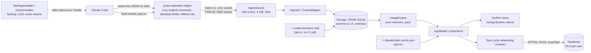

# Open-source readiness audit: Stage A

| | |
|---|---|
| Repository | `obileonardo/tokone` (private), branch `repo/open-source-readiness` |
| Audited commit | `9ee28c7` (`main` at the time of the audit) |
| Date | 17 Oct 2026 |
| Target licence | MIT (SPDX `MIT`) for original code |
| Scope | Working tree, full Git history (all local refs), GitHub repository settings (read-only), the generated documentation site in `site/`, and the project's private planning documents (read as evidence only; nothing copied in) |
| Mode | Read-only for code, build, configuration, history and settings. The only changes on this branch are additive documentation drafts (listed in §10) |

> **Keep this file private.** It describes security gaps and owner decisions. Review it, and remove or summarise it,
> before the repository becomes public (the drafts it proposes are written to be publishable; this report is not).

---

## 1. Executive summary

**What it is.** Pulse (working name; repository `tokone`) is a native Swift 6 / SwiftUI macOS menu bar app that
shows how much of a coding agent's usage limits are left and when they reset. It installs a small helper as Claude
Code's status-line command; the helper forwards an allowlisted subset of the status-line JSON to the app over a
same-user Unix socket. The app stores readings in SQLite (GRDB), derives limit states and a pace estimate with pure
state machines, and shows them in the menu bar and a Dashboard. Optional sources (Claude Code hooks, Claude Code's
statistics file, Codex session files) are opt-in. An optional accounts feature syncs daily counts to a Supabase
backend protected by row-level security.

**Engineering condition: strong.** On this machine `make ci` passes all 10 gates (strict Swift 6 build with warnings
as errors, 236 tests in 12 runs with no failures, helper linkage without networking, networking confined to one
module, injected clocks, design-token and redaction audits, secret scan, signed app bundle checks). The privacy
architecture is deliberate and test-backed: field allowlist, HMAC'd ids, canary-leak tests, reversible
compare-and-swap edits of `~/.claude/settings.json`, sandboxed tests that never touch the real home folder.

**Secrets and history: clean.** gitleaks 8.30.1 over all 28 commits and the working tree, plus targeted pattern
searches, found no credential. Its two hits are a synthetic test string and a Supabase *publishable* key, which is
designed to ship in apps. History has a single author using a GitHub `noreply` address.

**Primary release risks.**
1. **No licence** and the copyright holder is unconfirmed (blocker for an MIT release; owner decision).
2. **Forks and source builds sync to the maintainer's production backend** by default.
3. **External contributors cannot pass `make ci`**: the app target is pinned to the maintainer's signing team, and
   the toolchain to exactly Xcode 27.1.
4. **Repository governance is not ready**: `main` is unprotected, a second account has write access, and no GitHub
   security feature is enabled.
5. **Documentation depends on private material**: 239 references in 72 files point to planning documents that are not
   in the repository; the site generator reads them too.

**Recommendation: NOT READY — REMEDIATION REQUIRED.** No critical security exposure was found. The blocker is a
licensing and ownership decision, and the HIGH items are configuration and process work that Stage B can do without
touching the app's behaviour.

## 2. Repository and architecture overview

### 2.1 Project identity

| Item | Finding | Evidence |
|---|---|---|
| Name | Product "Pulse" (working name, trademark clearance pending per the private decision log); package and repo "Tokone" | `project.yml:3`, `Package.swift:6` |
| Purpose | Show AI coding-agent usage limits (Claude Code 5-hour and 7-day; Codex in progress) with freshness and pace | `Sources/PulseApp`, `Sources/UsageEngine` |
| Audience | Developers using Claude Code (and Codex) on macOS | — |
| Languages | Swift 6 (app, helper, CLI, tests); SQL (Supabase schema, pgTAP); Python 3 (site generators, fixture oracle); JavaScript/CSS/HTML (static site) | file inventory |
| Build tools | Swift Package Manager (source of truth), XcodeGen 2.46.0 (SHA-256 pinned download) → `xcodebuild`, Make, Supabase CLI + Docker (backend tests only) | `Package.swift`, `scripts/bootstrap.sh:6-7`, `Makefile` |
| Runtime | macOS 14+ (deployment target), menu bar only (`LSUIElement`), not sandboxed, hardened runtime | `project.yml:7,18,36,48` |
| Entry points | `App/PulseMac/PulseMacApp.swift` (app); `Sources/pulse-statusline/main.swift` (helper run by Claude Code, also `--hook`); `Sources/pulse/main.swift` (CLI); developer tools `pulse-fixture`, `pulse-design-render` | `Package.swift:14-20` |
| Server side | Optional Supabase project: 8 tables, RLS, `delete_account()`; local config for development | `backend/supabase/` |
| Environments | Local development only; the app's `SyncConfig.production` points at a hosted Supabase project; the site was deployed to Vercel (per commit messages) | `Sources/Sync/SyncConfig.swift:20-23`, `Makefile:29` |
| Distribution | None yet: no tags, releases, signed or notarized builds | `gh api …/tags`, `…/releases` |

### 2.2 Inventory

411 tracked files; `.git` pack 7.0 MiB.

| Path | Files | Contents |
|---|---|---|
| `Sources/` (16 targets) | 155 | Domain, ShimProtocol, StatusLineShim, pulse-statusline, ClaudeCodeAdapter, CodexAdapter, UsageEngine, Storage, SubscriptionCatalog, DesignSystem (+ 4 OFL fonts), PulseApp, Sync, pulse, FixtureTools, pulse-fixture, pulse-design-render, TestFixtures (61 fixture files) |
| `Tests/` (12 targets) | 34 | Swift Testing suites; `ShimIntegrationTests` runs the built helper against a temporary `HOME` |
| `backend/supabase/` | 4 | Migration, pgTAP isolation tests (16 checks), local `config.toml`, `.gitignore` |
| `design/screens/` | 19 PNG | App screenshots (demo data) |
| `site/` | 175 | Generated static documentation site (136 under `design-system/`), `vercel.json` |
| `scripts/` | 13 | `ci.sh`, `bootstrap.sh`, two site generators, fixture oracle, popover probe driver, site JS/CSS, vendored three.js r160 |
| Root | 6 | `Package.swift`, `Package.resolved`, `project.yml`, `Makefile`, `README.md`, `.gitignore` |
| Not present | — | `LICENSE`, `.github/`, community files, `.editorconfig`, `.gitattributes`, formatter config, Dockerfiles, IaC, submodules, Git LFS |

Generated and ignored: `.build/`, `build/`, `.tools/`, `*.xcodeproj`, `App/PulseMac/Info.plist`,
`App/PulseMac/PulseMac.entitlements` (generated by XcodeGen) (`.gitignore`).

### 2.3 Architecture



Module boundaries are explicit in `Package.swift` and enforced by CI greps: networking only in `Sync`
(`scripts/ci.sh:63-71`), no direct clock reads in pure layers (`ci.sh:73-79`), `unsafeReveal` only in `Storage` and
the helper (`ci.sh:94-102`), Theme tokens and pixel icons only (`ci.sh:82-91`). Dependency direction is clean: pure
`Domain` → `UsageEngine` → `Storage` → `PulseApp`; the helper depends only on `ShimProtocol`.

**Components that cannot run outside the maintainer's environment:** the signed app build (`project.yml:15-17`), the
site generator (`Makefile:21-29` reads the private docs folder on an external volume), the production Sync backend
(hard-coded project), and the absolute perf budget (`make perf`, enforced on the maintainer's Mac only).

**Architectural inconsistencies:** (a) the documented IPC design requires a code-signing check of the peer; the code
checks only the UID (F-06); (b) the installer supports a custom Claude config directory but the helper always reads
`$HOME/.claude` (F-15); (c) `Package.swift` declares iOS and watchOS platforms that no target builds for yet
(informational).

## 3. Open-source readiness scorecard

**Method.** Categories 1–14 carry weights summing to 100. Each earns a share of its weight from evidence: full for
PASS, partial for NEEDS IMPROVEMENT, none for FAIL. Category 15 is the overall verdict, not scored. **The score is
advisory and never overrides a blocker**: with B-1 open, the repository is not publishable whatever the number.

| # | Category | Status | Score | Evidence | Principal risks | Recommended actions | Priority |
|---|---|---|---|---|---|---|---|
| 1 | Security and credential hygiene | NEEDS IMPROVEMENT | 10/12 | gitleaks: 0 true positives (tree + 28 commits); CI secret scan; publishable key only; RLS + pgTAP; helper without networking | IPC peer check weaker than designed (F-06); backend abuse limits (F-07); GitHub secret scanning off (F-04) | F-06, F-07, enable secret scanning + push protection | High |
| 2 | Git history and privacy | PASS | 7/8 | Single author, `noreply` email; no secrets; 3 deleted files all benign; commit messages free of credentials | Owner's first name, design-reference notes and another project's name in history and comments (F-16, F-17) | Owner approves history as-is (recommended) | Medium |
| 3 | Copyright and MIT licensing | FAIL | 3/10 | No `LICENSE`; GitHub reports no licence; single human author; every commit has an AI co-author trailer | Cannot be released as MIT; holder unconfirmed; AI-assistance and employment/contract questions (F-13) | Confirm holder and year; add `LICENSE` (B-1) | Blocker |
| 4 | Third-party dependency compliance | NEEDS IMPROVEMENT | 5/6 | GRDB MIT (pinned revision); 3 OFL fonts with licences and SHA-256s; three.js MIT with licence; no copyleft | GRDB licence not shipped in the app bundle (F-08); vendor quotes in plan catalog (F-21) | Ship notices in the bundle; adopt `THIRD_PARTY_NOTICES.md` | Medium |
| 5 | Code quality and maintainability | PASS | 7/8 | Swift 6 mode, warnings as errors, consistent error types, documented intent, small focused modules | No formatter/linter config (F-19); a stale launch argument (F-14) | Add `swift format` lint (as planned) | Low |
| 6 | Architecture and modularity | PASS | 5/6 | Enforced boundaries (§2.3); pure reducers; injectable environment | Spec drift on IPC (F-06); production backend wired in (F-02) | F-02, F-06 | Medium |
| 7 | Test reliability | PASS | 7/8 | 236 tests passed, 0 failed; temp-`HOME` harness; canary leak tests; fixture oracle; pgTAP for RLS | No hosted CI; UI only checked by screenshots; perf budget local only | Hosted CI (F-10) | Medium |
| 8 | Build reproducibility | NEEDS IMPROVEMENT | 3/8 | `make ci` passes here; deps pinned; XcodeGen SHA-pinned | Signing identity and exact Xcode required (F-03); site needs private docs (F-09); first build clones a large GRDB submodule (~12 min here) | F-03, F-09 | High |
| 9 | Environment configuration | NEEDS IMPROVEMENT | 3/5 | Few variables (§7 below); no `.env` needed for the app; debug overrides for data and home folders | Backend endpoint hard-coded (F-02); no documented way to point at one's own Supabase | F-02 | High |
| 10 | Documentation quality | NEEDS IMPROVEMENT | 4/8 | Original README was 30 lines pointing at an external drive; detailed README drafted on this branch | 239 references to private docs (F-05); no public architecture/privacy docs | Adopt drafts; publish sanitised design docs (§9) | High |
| 11 | Contributor experience | NEEDS IMPROVEMENT | 2/5 | Drafted CONTRIBUTING, templates, CoC | Contributors cannot run the full gate (F-03); no labels; no hosted CI | F-03, F-10, labels | Medium |
| 12 | GitHub Actions and supply chain | NEEDS IMPROVEMENT | 3/6 | No workflows (no Actions attack surface yet); default token read-only; deps and XcodeGen pinned | Actions allow any action without SHA pinning; no Dependabot (F-10) | Restrict actions, require SHA pins, Dependabot | Medium |
| 13 | Repository governance | FAIL | 1/5 | `main` unprotected; rulesets unavailable on this private plan; write collaborator; all security features off | Direct pushes to `main`; no private vulnerability reporting (F-04) | `GITHUB_SETTINGS.md` | High |
| 14 | Release engineering | NEEDS IMPROVEMENT | 1/5 | Version 0.1.0 set in `project.yml:19`; signing planned | No tags, releases, changelog, notarization | Pre-release plan (§11 Phase 6) | Low (pre-launch) |
| 15 | Overall publication readiness | **NOT READY** | **61/100** | — | Blocker B-1 plus HIGH items F-02, F-03, F-04, F-05 | Phases 1–6 below | — |

## 4. Critical release blockers

| ID | Blocker | Why it blocks | Resolution |
|---|---|---|---|
| B-1 | **No licence, copyright holder unconfirmed** | Without a `LICENSE` the code is "all rights reserved"; publishing it would not make it open source, and an MIT grant needs the correct holder | Owner confirms holder (individual or company) and year, and answers the ownership questions in §12; then add the proposed text in `docs/open-source/proposed/LICENSE` as `/LICENSE` |

No credential exposure, unauthorised copyrighted material or exploitable production configuration was found within
the scope of this audit. That does not guarantee none exists (see the limits in §6.4).

## 5. Detailed findings register

Severity per the brief (BLOCKER, HIGH, MEDIUM, LOW, INFORMATIONAL). Confidence: High = confirmed in code or by a
command; Medium = strong inference; Low = possible, needs checking. "Owner" = owner approval needed.

### B-1 (BLOCKER) No licence; copyright holder unconfirmed
- **Confidence:** High. **Component:** repository root. **Owner:** yes.
- **Evidence:** `git ls-files` lists no `LICENSE`; `gh api repos/obileonardo/tokone` → `"license": null`.
- **Impact:** the repository cannot be published as MIT-licensed open source.
- **Remediation:** confirm holder and year; add `/LICENSE` from `docs/open-source/proposed/LICENSE`; mention MIT in
  README (drafted). No package manifest carries licence metadata, so nothing else needs updating.
- **Verification:** GitHub's licence detector shows "MIT" on the repository page; `gh api …` returns `spdx_id: MIT`.

### F-02 (HIGH) Source builds and forks talk to the maintainer's production backend
- **Confidence:** High. **Component:** `Sync`, `PulseApp`. **Owner:** yes (architecture and data-protection choice).
- **Evidence:** `Sources/Sync/SyncConfig.swift:20-23` hard-codes a hosted Supabase project URL (`https://mlln…supabase.co`)
  and its publishable key; `Sources/PulseApp/System/AppEnvironment.swift:79` always uses `.production`.
- **Explanation:** the publishable key is not a secret (it grants nothing without a user session, and every table has
  RLS). But once the source is public, every fork or local build signs users into, and uploads their daily counts
  to, the maintainer's project. The maintainer becomes responsible for that data, its cost and abuse handling, and
  a modified fork could present itself as "Pulse" to the same backend.
- **Remediation (smallest safe change):** read the project URL and publishable key from build configuration (for
  example an `xcconfig`-driven `Info.plist` key, with the maintainer's values in an ignored local file or the
  release pipeline); when absent, hide sign-in and make Sync inert. Keep `make ci`'s "networking only in Sync" gate.
- **Verification:** a clean clone builds with Sync disabled; a test asserts that no request is made without
  configuration; the maintainer's release build still signs in.

### F-03 (HIGH) External contributors cannot pass `make ci` or build the app
- **Confidence:** High (configuration read; not executed without the identity). **Component:** `project.yml`,
  `scripts/ci.sh`. **Owner:** no (technical), but review.
- **Evidence:** `project.yml:15-17` (`DEVELOPMENT_TEAM` set to the maintainer's team, `CODE_SIGN_STYLE: Manual`,
  `CODE_SIGN_IDENTITY: Apple Development`); `scripts/ci.sh:8-9,34-41` require exactly Xcode 27.1 and Swift 6.4;
  `ci.sh:150` always runs the app-bundle gate.
- **Impact:** a contributor without that certificate gets a failing `make ci`; the proposed hosted CI cannot run the
  app gate either.
- **Remediation:** allow ad-hoc signing when no team is configured (team and identity from an overridable
  `xcconfig`), and add `scripts/ci.sh --skip "<gate>"` so CI and contributors can run the other nine gates.
  Document the exact toolchain (done in the README draft).
- **Verification:** `make ci` passes on a machine without the certificate, with the app gate reported as skipped.

### F-04 (HIGH) Repository governance and GitHub security features not configured
- **Confidence:** High. **Component:** GitHub settings. **Owner:** yes (manual configuration).
- **Evidence:** `gh api …/branches` → `main` `"protected": false`; protection and rulesets return HTTP 403 "Upgrade to
  GitHub Pro or make this repository public"; Dependabot alerts and security updates disabled; secret scanning
  disabled; code scanning not enabled; private vulnerability reporting 404; Actions `allowed_actions: all`,
  `sha_pinning_required: false`; collaborators: the owner (admin) and one other account with `write`.
- **Impact:** anyone with write access can push to `main`; no automated detection of leaked secrets or vulnerable
  dependencies; no private channel for vulnerability reports.
- **Remediation:** `docs/open-source/GITHUB_SETTINGS.md`. Before public: review the collaborator, restrict Actions,
  enable Dependabot, private vulnerability reporting, secret scanning and push protection. At public: ruleset on
  `main`, CodeQL.
- **Verification:** re-run the `gh api` reads listed in `GITHUB_SETTINGS.md`.

### F-05 (HIGH) Code and docs depend on private planning documents
- **Confidence:** High. **Component:** comments across `Sources/`, `Tests/`, `scripts/`, `Makefile`, `Package.swift`.
  **Owner:** yes (which documents to publish).
- **Evidence:** 239 references in 72 files to `ROADMAP`, `DECISIONS`, `ARCHITECTURE`, `PRIVACY_AND_SECURITY`,
  `DATA_MODEL`, `DESIGN_SYSTEM`, `statusline-shim` spec, ADR-001…005 and others (e.g. `Package.swift:2`,
  `Sources/ClaudeCodeAdapter/IngestSocket.swift:29`); the original `README.md:3-4,29` pointed to "the docs folder on
  the external drive".
- **Impact:** external readers meet dangling references for the key design rules (allowlist, IPC, time budget).
- **Remediation:** publish sanitised versions of the design documents that the code cites (§9), under `docs/`, so the
  references resolve; keep decision logs and pending lists private.
- **Verification:** a script lists every cited document name and checks it exists under `docs/`.

### F-06 (MEDIUM) Socket peer validation is weaker than the documented design
- **Confidence:** High. **Component:** `ClaudeCodeAdapter/IngestSocket.swift`. **Owner:** decide accept or fix.
- **Evidence:** `IngestSocket.swift:158` checks only `getpeereid` UID; no `LOCAL_PEERTOKEN`/`SecCode` check exists in
  `Sources/`. The private security design (§3, IPC peer validation) specifies a code-signing requirement on the peer.
- **Explanation and impact:** any process running as the same user can send well-formed frames and make Pulse show
  false limit readings (integrity, not confidentiality: the socket only receives). Such a process could already edit
  `~/.claude` directly, so the incremental risk is small, but the public description must not overstate the check.
- **Remediation:** implement the designed audit-token + code-requirement check (with the ad-hoc `cdhash` path for
  debug builds), or record it as accepted risk. The drafted README and SECURITY.md describe current behaviour only.
- **Verification:** a test connecting from an unsigned binary is rejected and counted in `rejectedPeer`.

### F-07 (MEDIUM) Backend lacks abuse limits; production auth settings not in the repository
- **Confidence:** Medium. **Component:** `backend/supabase/migrations/20261017000000_pulse_accounts.sql`,
  `config.toml`. **Owner:** yes.
- **Evidence:** RLS is correct (`:84-94`, forced, `anon` revoked, 16 pgTAP checks). But `day` columns accept any date
  (`:17,27,48,57,74`), `daily_agents.by_type` jsonb has no size limit (`:60`), and sign-up is open
  (`config.toml` `[auth] enable_signup = true`). `config.toml` configures only the local stack; the hosted project's
  auth, rate-limit and CAPTCHA settings are not visible here (**not verified**).
- **Impact:** a signed-up user can write unbounded rows or large JSON into their own rows (cost, storage); email
  sign-in can be used to send mail to arbitrary addresses within Supabase's rate limits.
- **Remediation:** `check` constraints (date range, `pg_column_size(by_type)` bound, object key pattern); confirm
  hosted rate limits and CAPTCHA; monitor usage.
- **Verification:** pgTAP cases for the new constraints; review of hosted project settings.

### F-08 (MEDIUM) GRDB's licence is not shipped with the app
- **Confidence:** High. **Component:** app bundle. **Owner:** no.
- **Evidence:** `find …/Pulse.app -iname '*licen*'` finds only the three OFL texts (inside
  `Tokone_DesignSystem.bundle`); GRDB (MIT) is linked into the app.
- **Impact:** MIT requires the notice in "all copies or substantial portions"; a binary release without it would
  not comply.
- **Remediation:** add an acknowledgements resource (GRDB MIT text, OFL notices) to the app, or ship it beside the
  DMG. Not needed for a source-only release.
- **Verification:** the file is present in the built bundle; a CI check asserts it.

### F-09 (MEDIUM) Site generation needs private documents and personal machine paths
- **Confidence:** High. **Component:** `Makefile:21-29`, `scripts/build-site.py:247,404,576`. **Owner:** yes.
- **Evidence:** `DOCS := /Volumes/<owner's volume>/Tokone/docs`; `build-site.py` reads `ROADMAP.md` and
  `ARCHITECTURE.md` from it; `make design-site` ends with `rm -rf "$(DOCS_DESIGN)"` and a `vercel deploy` hint with the
  owner's Vercel scope. The generated `site/` is committed.
- **Impact:** contributors cannot regenerate `site/`; committed generated output can go stale; the path discloses the
  owner's full name and volume layout. (On another machine the build fails at reading the docs, before the `rm -rf`
  line, so it is not destructive there.)
- **Remediation:** make the docs path a variable defaulting to an in-repo `docs/`; move the deploy hint to private
  notes; decide whether `site/` stays committed or is built in CI.

### F-10 (MEDIUM) No hosted CI or dependency automation; permissive Actions policy
- **Confidence:** High. **Component:** `.github/` (absent), Actions settings. **Owner:** yes.
- **Evidence:** no `.github/workflows`; `actions/permissions` → `allowed_actions: all`, `sha_pinning_required: false`;
  no `dependabot.yml`.
- **Remediation:** adopt `docs/open-source/proposed/ci.yml` (after F-03) and `proposed/dependabot.yml`; restrict
  actions and require SHA pins.

### F-11 (MEDIUM) Screenshot provenance and freshness
- **Confidence:** Medium. **Component:** `design/screens/`, `site/screens/img/`, `site/design-system/img/screens/`.
  **Owner:** yes.
- **Evidence:** screens are badged DEMO, but the Stats pages read "the synthetic file the probe's home provides"
  (`Sources/PulseApp/Debug/PopoverProbe.swift:45`), which is not in the repository, so the provenance of the
  activity calendar, card and arena figures cannot be verified from the repo. The profile name in the screens comes
  from the macOS account's full name (`AppModel.swift:132`), so they show the owner's first name. Views are being
  redesigned on another branch, so these images will be out of date once it merges. PNG metadata holds only standard
  screenshot XMP (dimensions), no paths or user names.
- **Remediation:** commit a synthetic stats file for the probe, set a neutral profile name for captures, and
  regenerate all screenshots after the design branch lands.

### F-12 (MEDIUM) Product name and branding not cleared
- **Confidence:** Medium. **Owner:** yes.
- **Evidence:** "Pulse (working name)" throughout; the private decision log records an open naming decision with a
  suggested clearance search; package and repo use "Tokone"; bundle id prefix `dev.tokone` marked placeholder
  (`project.yml:5`).
- **Remediation:** decide the public name before public assets (repo name, site, social preview); consider a short
  trademark policy if the name is to be reserved.

### F-13 (MEDIUM) Copyright provenance questions for legal review
- **Confidence:** Medium (inference). **Owner:** yes; legal review advised.
- **Evidence:** all 28 commits by one human author; all carry a `Co-Authored-By: Claude` trailer; one other account
  has write access but no commits.
- **Explanation:** MIT can only be granted by whoever holds the rights. Questions: whether any work was made under
  an employment or contractor agreement that assigns it to a company; whether the collaborator contributed anything
  outside Git (designs, assets); and how the owner wants to treat AI-assisted code (generally the human author's to
  license, but the owner may want advice). No conclusion is drawn here.

### F-14 (LOW) Documented launch argument that does nothing
- **Evidence:** `-PulseMeasurePopover N` appears in the original README (`README.md:18`) and
  `PopoverProbe.swift:10`, but no code reads it; the count goes to `scripts/probe-popover.swift`. The README draft
  documents the working usage. **Remediation:** fix the doc comment.

### F-15 (LOW) Latent: custom Claude config directory and the helper disagree
- **Evidence:** `SettingsInstaller.Paths(home:claudeConfigDir:)` writes `config.json` under the custom directory
  (`SettingsInstaller.swift:27-31`), but the helper always reads `$HOME/.claude/pulse/config.json`
  (`StatusLineShim.swift:103-104`). With a custom directory the helper would find no config and the user's original
  status line would not run. Not reachable today: the app and CLI never pass a custom directory (`AppModel.swift:710`,
  `pulse/main.swift:24`). **Remediation:** pass the config path to the helper (wrapper argument or environment)
  before wiring `CLAUDE_CONFIG_DIR` into the app; add a test.

### F-16 (LOW) Internal notes and third-party design references in public files
- **Evidence:** a comment and site text name another, unrelated private project of the owner
  (`Sources/DesignSystem/Theme/Tokens.swift:135`, `scripts/build-design-site.py:263`,
  `site/design-system/index.html:123`); design-reference products and "the founder's Mobbin picks" in comments
  (`Sources/PulseApp/Copy/Copy.swift:223-316`, `Dashboard.swift:199-269`), commit messages and the site
  (`site/index.html`, `progress/`, `changelog/`: 52 "founder" mentions, 19 "Mobbin"). Not secret; a tone and
  disclosure choice. **Remediation:** owner decides; if desired, reword comments and site copy (history would keep
  the commit messages unless rewritten, which is not recommended for this).

### F-17 (LOW) Owner's first name in tests and screenshots
- **Evidence:** `Tests/PulseAppTests/DashboardTests.swift:18-22,41,84`, `AccountSyncTests.swift:39`,
  `Tests/SyncTests/SyncClientTests.swift:95`, `Sources/PulseApp/Dashboard/Dashboard.swift:8`; screenshots (F-11). The
  full name is already public as the commit author. **Remediation:** optional; use a neutral name.

### F-18 (LOW) Sign-in error text can be set by any local caller of the URL scheme
- **Evidence:** `SyncClient.swift:192` throws the `error_description` from the callback URL, and
  `AppModel.swift:475,547` shows it in the Account page. Any app or web page can open
  `dev.tokone.pulse://auth-callback?error_description=…`. PKCE prevents session injection (the code is useless
  without the verifier in this Mac's Keychain). **Impact:** misleading text in the app (phishing-style message).
  **Remediation:** map provider errors to fixed copy, or cap length and show it as "the provider said: …".

### F-19 (LOW) Repository hygiene configuration
- **Evidence:** no `.editorconfig`, `.gitattributes`, or formatter/linter config (the private CI plan intends
  `swift format lint --strict`); root `.gitignore` does not cover `.env*`, `*.p12`, `*.cer`, `*.mobileprovision`,
  `*.sqlite*`, `*.jsonl` exports (`backend/supabase/.gitignore` covers `.env.local`/`.env.keys` there).
  **Remediation:** add these guards before the first outside contribution.

### F-20 (LOW) Duplicated binary assets
- **Evidence:** each screenshot exists three times (`design/screens`, `site/screens/img`,
  `site/design-system/img/screens`); three.js and Silkscreen twice. 173 PNGs. **Remediation:** if `site/` stays
  committed, accept; otherwise build it in CI.

### F-21 (LOW) Verbatim vendor text in the plan catalog
- **Evidence:** 32 `sourceQuote` strings in `Sources/SubscriptionCatalog/Resources/plan-catalog.v1.json`, each with
  `sourceURL`. Short, attributed quotations; noted in the notices draft. **Remediation:** keep them short; owner may
  prefer paraphrase.

### F-22 (INFORMATIONAL) Scrubbed real capture in fixtures
- **Evidence:** `Sources/TestFixtures/Resources/claude-code/captured/2.1.302/C01-real-session/` is a real session,
  scrubbed (`meta.json`: `scrubbed: true`, 7 scrubs; paths `/fixture/path`, ids replaced). It still holds real
  aggregate values (cost estimate, line counts, durations, token counts) and the display time zone. Earlier history
  versions are equally scrubbed. **Owner:** approve publishing, or replace with synthetic values.

### F-23 (INFORMATIONAL) Scanner hits that are not secrets
- `Sources/Sync/SyncConfig.swift:22`: Supabase publishable key (`sb_p…`), public by design. **Do not rotate** on
  account of publication; rotate only if the owner wants a fresh project for the public build (see F-02).
- `Tests/ShimProtocolTests/FrameBuilderTests.swift:216` (history: `:201` in `7aa1026`): `AKIA…` followed by 16
  sequential letters, a synthetic scrubber input marked `secret-scan: allow`.

### F-24 (INFORMATIONAL) Apple Team ID in `project.yml:15`
- Team IDs are embedded in every signed binary and are not secret; listed so it is a conscious choice. It would be
  removed from the shared configuration by F-03.

### F-25 (INFORMATIONAL) Parts of the project may already be public
- Commit `e24bf5c` and `Makefile:29` indicate the documentation site was deployed to Vercel. Whether that deployment
  is publicly reachable was **not verified** (no request was made). If it is, everything under `site/` (progress,
  changelog, screenshots, design system) is already public.

### F-26 (INFORMATIONAL) Local branches not on the remote
- Local worktree branches `brand/identity`, `design/themes-premium` and this branch exist only locally; the remote has
  only `main`. Publishing the existing repository exposes only what has been pushed.

## 6. Security and privacy assessment

### 6.1 Working tree

| Check | Method | Result |
|---|---|---|
| Secrets | gitleaks 8.30.1 `dir --redact`; CI regex scan; targeted searches for `sb_secret_`, `service_role`, JWTs, private keys, AWS/GitHub/Slack/Anthropic token shapes | No true positive (F-23) |
| Personal data | Searches for emails, phone numbers, private IPs, home and volume paths, names | Emails: only template and font-licence addresses and synthetic test addresses; no phone numbers or IPs; one volume path with the owner's name (`Makefile:21`); first name in tests (F-17) |
| Binary metadata | `strings` over all 173 PNGs | Standard screenshot XMP only; no user names or paths |
| Confidential documents | Inventory | None committed; private planning docs live outside the repository |

### 6.2 Git history

| Check | Result |
|---|---|
| Commits, refs | 28 commits on `main` (all local refs scanned: `--all`); no tags |
| gitleaks `git --log-opts=--all --redact` | 2 hits, both F-23 |
| Authors / committers | One identity, `74096579+obileonardo@users.noreply.github.com` |
| Deleted files | `design/screens/settings-diagnostics.png`, its site copy, and `Sources/PulseApp/Views/Details/SessionAndStatsTabs.swift`: benign |
| Historical fixture versions | Equally scrubbed (paths `/fixture/path`, synthetic canaries) |
| Commit messages | No credentials; contain process notes, design references and real usage anecdotes ("Real ~/.codex: a reading in 47 ms") |

**Conclusion:** the existing history can safely become public, subject to the owner accepting F-16 and F-22. A fresh
history is not required for security reasons. Rewriting history would not un-publish anything already pushed or
deployed, and would lose useful provenance.

### 6.3 Application security (including the AI-agent integration)

| Area | Assessment | Evidence |
|---|---|---|
| Data minimisation from Claude Code | Strong: typed allowlist, path/email/secret-shaped strings dropped, session ids HMAC'd with a per-install 32-byte key (0600), canary tests across all fields and hook events | `ShimProtocol/Allowlist.swift`, `HookFrame.swift`, `Tests/ShimIntegrationTests/CanaryLeakTests.swift`, `HookModeTests.swift` |
| Helper robustness | Fail-open: user's command runs first with exact bytes; stdin ceiling 1 MiB; time budget; no disk writes; `SIGPIPE` ignored; signals forwarded; hook mode always exits 0 silently (cannot block or inject context into Claude Code) | `StatusLineShim.swift:34-88` |
| Command execution | The original status-line command is run via `/bin/sh -c` from `~/.claude/pulse/config.json` (0600); the wrapper single-quotes paths correctly. Anyone able to write that file can already edit `~/.claude/settings.json`, so no new trust boundary | `StatusLineShim.swift:131-158`, `SettingsInstaller.swift:426-440` |
| Settings edits | Backup before change, compare-and-swap, atomic rename, symlink refusal (`O_NOFOLLOW`, `lstat`), recovery state machine, exact restore | `SettingsInstaller.swift`, `HooksInstaller.swift`, 3 test files |
| Local IPC | Dir 0700 owned by user, socket 0600, stale-socket-only replacement, UID check, 4 KiB, 20/s, 100 ms read timeout. Gap: no code-signing check (F-06) | `IngestSocket.swift:71-181` |
| Other file readers | Stats file through an allowlist, not stored; Codex: only `token_count` lines from the last 256 KB of 3 files, other lines skipped before JSON decoding | `StatsReader.swift`, `CodexReader.swift`, `CodexRollout.swift` |
| Prompt injection | Not applicable in the LLM sense: Pulse never sends agent output to a model and never executes agent-provided content. Agent-provided strings are length-limited and scrubbed before display | — |
| Sync auth | PKCE email link, state bound by verifier; ephemeral `URLSession` (no cookies/cache); Keychain item `AfterFirstUnlockThisDeviceOnly`; refresh failure signs out; debug runs use in-memory auth | `SyncClient.swift`, `AppEnvironment.swift:68-72` |
| URL scheme | Scheme and host checked; error text injectable (F-18) | `SyncClient.swift:187-192` |
| Backend | RLS forced on all 8 tables, `anon` revoked, `security definer` functions with empty `search_path`, account deletion cascades; abuse limits missing (F-07) | migration, `isolation.test.sql` |
| Logging | `Redacted<T>` non-Codable; CI audit of `unsafeReveal`; diagnostics log designed without paths | `Domain/Redacted.swift`, `ci.sh:94-102` |
| Entitlements | None beyond debug `get-task-allow`; hardened runtime; CI asserts both | `ci.sh:114-138` |
| Website | Static; no third-party requests (three.js and fonts self-hosted); no forms. Security headers not configured (`site/vercel.json` sets only `trailingSlash`) — LOW, static content | `site/` |

**Adversarial view (public repository, malicious actor):** reading the source reveals no credentials or private
endpoints beyond the intended public Supabase identifiers. Realistic attacks are (1) abusing the hosted backend via
the public key (F-02, F-07), (2) a malicious fork distributed as "Pulse" that drops the allowlist (a distribution and
naming problem: signed releases and a clear official download location mitigate), (3) pull requests that widen the
allowlist or add network calls (mitigated by CI gates, the PR template's privacy section and required review), and
(4) a compromised GitHub Action once CI exists (mitigated by SHA pinning and least-privilege tokens). Making the
source public is not itself a vulnerability here.

### 6.4 Limits of this audit

- History coverage is all local refs at the time of the scan; GitHub-side artefacts (issues, Actions logs,
  deployments) were checked only through the settings API listed in `GITHUB_SETTINGS.md`.
- No dynamic security testing was run against the hosted Supabase project or the Vercel site (out of scope; not
  authorised).
- trufflehog, semgrep and osv-scanner are not installed and were not installed. GRDB 7.11.1 was not checked against an
  advisory database (**not verified**).
- The external planning documents were read selectively (decisions, CI plan, security design, roadmap), not in full.

## 7. MIT licensing and intellectual property assessment

| Item | Finding | Action |
|---|---|---|
| Original code | One human author; AI-assisted commits | Owner confirms holder (B-1, F-13) |
| Licence file | Absent | Add after confirmation (B-1) |
| Licence metadata | No manifest field exists for it in SwiftPM/XcodeGen | None |
| GRDB.swift 7.11.1 | MIT, compatible; transitive `SQLiteLib` submodule fetched but not compiled; links system SQLite | Ship notice in binaries (F-08) |
| Fonts | Silkscreen, Pixelify Sans, VT323: OFL 1.1, licences beside files and inside the bundle; SHA-256s match `Fonts/README.md` (verified) | Compatible; keep licences together with fonts |
| three.js r160 | MIT, licence beside the vendored file; site only | Keep `three-LICENSE.txt` |
| XcodeGen | MIT, build tool only, not distributed | None |
| Screenshots and renders | Generated by Pulse from demo data (provenance caveat F-11) | Owner confirms |
| Pixel glyphs, menu bar icon, favicon | Drawn in code / inline SVG in this repository | Covered by the project licence once granted |
| Plan catalog quotes | Short attributed vendor quotations (F-21) | Keep short |
| Trademarks | Claude, Claude Code, Codex, ChatGPT, Gemini, Grok, Cursor, GitHub Copilot, Windsurf named (site: 49 "Claude Code", 9 "Codex", 9 "Gemini", 3 each "Cursor", "GitHub Copilot", "Windsurf"); no logos found; sign-in providers drawn as monograms | Nominative use with a non-affiliation notice (drafted in README and notices) |
| Own branding | "Pulse" not cleared (F-12) | Owner decision |

Drafted: `THIRD_PARTY_NOTICES.md`, `docs/open-source/proposed/LICENSE` (holder and year left as placeholders).

## 8. Code quality and architecture assessment

Strengths an external reviewer will notice: explicit module boundaries enforced by CI; pure, clock-injected state
machines with property-style tests; careful POSIX code in the helper (non-blocking connect with deadlines,
`EINTR` handling, no Swift concurrency runtime in the hot path); data-loss-averse installers; migrations that keep
every row with tests and negative controls; consistent, explanatory comments.

Improvement opportunities, none blocking:

1. Configuration seams for public builds: backend (F-02) and signing (F-03).
2. Finish or downgrade the IPC peer check (F-06); fix the latent config-path mismatch before supporting
   `CLAUDE_CONFIG_DIR` (F-15).
3. Add the planned `swift format` lint and an `.editorconfig` (F-19).
4. Resolve dangling design-document references (F-05). The many "founder" process comments are harmless but read
   as internal; trim opportunistically.
5. `AppModel.swift` is 850 lines and `SettingsInstaller.swift` 568; both are cohesive, so no split is recommended
   before release.
6. Public interfaces: the Swift libraries are `public` for module boundaries, not as a supported SDK. State in the
   README (drafted: "Project layout") that only the app, the helper and the `pulse` CLI are supported; frame v1 and
   the database schema are internal and versioned.

## 9. Documentation and contributor experience assessment

| Need (brief §9–10) | Before | Drafted on this branch |
|---|---|---|
| README covering purpose, features, platforms, stack, architecture, install, run, CLI, layout, testing, build, troubleshooting, contributing, security, status, licence, acknowledgements | 30-line developer note | Complete rewrite, every claim checked against source |
| Architecture docs with diagrams | Private only | Mermaid diagram in README; publish sanitised `ARCHITECTURE.md` (below) |
| CONTRIBUTING | None | Drafted |
| CODE_OF_CONDUCT | None | Contributor Covenant 2.1, verbatim except the contact placeholder |
| SECURITY | None | Drafted; uses GitHub private reporting; email placeholder |
| Issue / PR templates | None | Bug, feature, documentation forms; config pointing security reports to advisories; PR template with privacy checklist |
| THIRD_PARTY_NOTICES | None | Drafted |
| CHANGELOG | None (site has a generated changelog from commits) | Recommend starting `CHANGELOG.md` at the first tag |
| SUPPORT.md | None | Not needed yet (issues suffice) |
| CODEOWNERS | None | Optional with one maintainer; add if a second maintainer joins |
| `.env.example` | None | Not needed for the app; needed for the backend only if F-02 introduces build-time configuration |
| Labels / first issues | None | Listed in `GITHUB_SETTINGS.md`; candidates: neutral-name screenshots (F-11, F-17), `.editorconfig` (F-19), fixing F-14 |

**Private documents: recommendation for the public repository** (each needs a content review before copying; this
audit did not read all of them in full):

| Document | Recommendation |
|---|---|
| `ARCHITECTURE.md`, ADR-001…005, `specs/statusline-shim.md`, `DATA_MODEL.md`, `DESIGN_SYSTEM.md`, `TEST_PLAN.md`, `fixtures/README.md`, `MULTI_AGENT.md`, `INTEGRATIONS.md`, `PLAN_CATALOG.md` | Publish sanitised copies under `docs/`: the code cites them and they explain the design rules |
| `PRIVACY_AND_SECURITY.md` | Publish a public version (threat model, allowlist, retention, export/delete); keep anything about unfixed gaps out until fixed |
| `UX_SPEC.md`, `CAPABILITY_MATRIX.md`, `NOTIFICATIONS_AND_SCHEDULING.md` | Optional; useful to contributors |
| `ROADMAP.md` | Publish a summary (the README draft has one); keep evidence logs and founder-input columns private |
| `DECISIONS.md`, `PENDING.md`, `IMPLEMENTATION_PLAN.md`, `COMPLIANCE_GATES.md`, `BACKEND_AND_FEED.md`, `ACCOUNTS_AND_SYNC.md`, `RELEASE_AND_CI.md`, `SITE_REDESIGN.md`, `evidence/`, `runbooks/` | Keep private (personal decisions, account identifiers, business and infrastructure plans) |

## 10. Proposed file changes

### Drafted on this branch (additive; no code, build or config changed)

| File | Purpose |
|---|---|
| `README.md` (rewritten) | Public README: purpose, features as built, screenshots, privacy model, Mermaid architecture, requirements, build, safe run, CLI, CI gates, layout, backend, status, limitations, troubleshooting, licence, trademarks |
| `CONTRIBUTING.md` | Setup, conventions mapped to CI gates, test rules (sandboxed homes, fixtures, canaries), changes that need design discussion, commits, review |
| `SECURITY.md` | Private reporting via GitHub, contact placeholder, scope, response targets |
| `CODE_OF_CONDUCT.md` | Contributor Covenant 2.1 |
| `THIRD_PARTY_NOTICES.md` | GRDB, fonts, three.js, tools, vendor text, trademarks |
| `.github/ISSUE_TEMPLATE/{bug_report,feature_request,documentation,config}.yml` | Issue forms |
| `.github/pull_request_template.md` | PR checklist with privacy and verification sections |
| `docs/open-source/STAGE_A_AUDIT.md` | This report (keep private) |
| `docs/open-source/GITHUB_SETTINGS.md` | Manual GitHub configuration with observed state |
| `docs/open-source/proposed/LICENSE` | MIT text with placeholders |
| `docs/open-source/proposed/ci.yml` | Hosted CI proposal (inactive) |
| `docs/open-source/proposed/dependabot.yml` | Dependabot proposal (inactive) |

### Proposed for Stage B (need approval)

| Change | Finding | Why |
|---|---|---|
| Add `/LICENSE` | B-1 | Licence grant |
| Backend configuration from build settings; Sync inert without it | F-02 | Forks must not use the maintainer's backend |
| Overridable signing; `ci.sh --skip` | F-03 | Contributors and CI can run the gates |
| Socket code-signing check, or documented acceptance | F-06 | Match the design |
| Backend `check` constraints; review hosted auth settings | F-07 | Abuse limits |
| Acknowledgements resource in the app | F-08 | MIT notice in binaries |
| `DOCS ?=` default in `Makefile`; remove deploy hint | F-09 | Portability, personal path |
| Publish sanitised design docs under `docs/` | F-05 | Resolve references |
| Synthetic stats file for the probe; neutral capture name; regenerate screenshots after the design branch | F-11, F-17 | Provenance, freshness |
| Fix `PopoverProbe.swift:10` comment; fixed error copy for callbacks | F-14, F-18 | Accuracy |
| `.editorconfig`, `.gitattributes`, `.gitignore` guards, `swift format` lint | F-19 | Hygiene |
| Move `.github` workflow and Dependabot proposals into place | F-10 | Automation |

Nothing is proposed for deletion.

## 11. Implementation plan

| Phase | Work | Depends on |
|---|---|---|
| 1. Critical security and publication blockers | No credential to revoke. Review the write collaborator; enable secret scanning, push protection, Dependabot, private vulnerability reporting where the plan allows | Owner |
| 2. Licensing and ownership | Answer §12 questions 1–4; add `LICENSE`; adopt `THIRD_PARTY_NOTICES.md`; decide the public name (F-12) | Owner, possibly legal advice |
| 3. Code, build and environment | F-02, F-03, F-06, F-07, F-08, F-09, F-15, F-18, F-19; each with tests and `make ci` green | Phase 2 for F-02 scope decisions |
| 4. Documentation and contributor readiness | Merge drafts (adjusted to Phase 3 changes); publish sanitised design docs (F-05); regenerate screenshots after the design branch (F-11); labels | Phase 3, design branch |
| 5. GitHub configuration and automation | Adopt CI and Dependabot; restrict Actions; at public: ruleset on `main`, CodeQL | F-03 |
| 6. Final release validation (Stage C) | Re-run gitleaks over the exact tree and history to publish; `make ci` on a machine without the maintainer's certificate; verify `GITHUB_SETTINGS.md`; decide first tag (`v0.1.0-alpha.1`), changelog; GO/NO-GO | Phases 1–5 |

**Distribution strategy.** Publish the existing repository (history reviewed and clean) rather than a new one: it
keeps provenance and needs no history rewrite. A fresh repository is only worth it if the owner wants to drop the
commit-message process notes (F-16); that is a presentation choice, not a security need. Either way, the protected
reference environment (the maintainer's local install and data under `~/.claude` and Application Support) is not
touched by any proposed change; the tests already run in temporary homes.

**Versioning.** Semantic Versioning with pre-release tags (`0.1.0-alpha.N`) until notarized builds exist; frame and
schema versions stay internal. No API stability is claimed.

## 12. Questions requiring owner decisions

1. **Copyright holder and year** for `LICENSE`: you personally, or a company?
2. **Employment or contracts:** was any of this created under an employment or contractor agreement (including with a
   company whose email address you use) that could assign it elsewhere?
3. **The second collaborator with write access:** who is it, did they contribute anything (code, designs, assets)
   outside Git, and should they keep write access?
4. **AI-assisted code:** are you comfortable releasing it under your copyright as is, or do you want legal advice first?
5. **Security contact** for `SECURITY.md` and **conduct contact** for `CODE_OF_CONDUCT.md`: GitHub private reporting
   only, or also an address (a project alias rather than a personal email is recommended)?
6. **Backend for public builds (F-02):** should source builds have Sync disabled by default, and should your hosted
   project stay tied to official builds only?
7. **Public name (F-12):** keep "Pulse", or decide before going public? Rename the repository from `tokone`?
8. **Publication scope:** publish `site/` and its generated content, the scrubbed real capture C01 (F-22), and the
   commit history with its process notes (F-16)?
9. **Private design docs:** approve publishing sanitised versions of the documents listed in §9?
10. **Release status:** call the first public release an alpha (recommended) and when?

## 13. Overall recommendation

**NOT READY — REMEDIATION REQUIRED.**

The code is in good shape and its privacy design holds up; no secret or confidential-data exposure was found in the
tree or the history. Publication is blocked by the missing licence and the unconfirmed copyright holder (B-1), and
should wait for the HIGH items: forks using the production backend (F-02), contributors unable to run the gates
(F-03), unprotected repository settings (F-04), and documentation that depends on private files (F-05). All of these
can be fixed without changing what the app does for its current user.

Stop here: Stage B changes need the owner's approval.

---

### Appendix A. Commands run

Read-only unless noted. Secrets were never printed; outputs were redacted at the source.

```
git status; git log --all --oneline --graph; git branch -a; git worktree list; git tag
git log --all --format='%an <%ae> | %cn <%ce>' | sort | uniq -c
git log --all -p --no-color > (scratch file)          # history text for pattern searches
git log --all --diff-filter=D --name-only               # deleted files
gitleaks git --redact --log-opts=--all --report-format json
gitleaks dir --redact --report-format json
grep searches (emails, phone numbers, private IPs, paths, names, token shapes, service keys) over tree and history
strings over every tracked PNG (metadata)
shasum -a 256 on fonts and vendored three.js; cmp of duplicate assets
make ci                                                  # builds into .build/, build/, .tools/ of this worktree
find Pulse.app for licence files
gh auth status; gh api GET … (list in GITHUB_SETTINGS.md)
curl the Contributor Covenant 2.1 source text (raw.githubusercontent.com) into a scratch folder
```

### Appendix B. `make ci` result (this branch, commit `9ee28c7` tree)

```
PASS  toolchain pinned (0s)
PASS  strict build (warnings=errors) (706s)      # includes first-time clone of GRDB and its submodule
PASS  tests (46s)                                # 236 tests in 12 runs, 0 failures; perf suite skipped without PULSE_PERF
PASS  helper links no networking (6s)
PASS  networking only in Sync (0s)
PASS  clock injected (0s)
PASS  design tokens only (0s)
PASS  redaction audit (0s)
PASS  secret scan (0s)
PASS  app bundle (54s)
ALL CHECKS PASSED
```

Not run: `make perf` (machine-specific budget), `make backend-test` (needs Docker and the Supabase CLI; not started),
`make site` (reads private documents and deletes/replaces a folder outside the repository).

### Appendix C. Environment variables and launch arguments

| Name | Kind | Used by | Required | Notes |
|---|---|---|---|---|
| `HOME` | env | helper, CLI | Yes (system) | Locates `~/.claude/pulse/config.json` |
| `COLUMNS` | env | helper | Optional | Width of the helper's own status line |
| `PULSE_SHIM_NOW_MS` | env | helper, **debug builds only** | Tests | Fixed clock for fixtures; ignored in release |
| `PULSE_SHIM` | shell variable | generated wrapper scripts | Internal | Path to the helper, written by the installers |
| `PULSE_PERF` | env | `make perf` / overhead test | Optional | Enables the perf suite |
| `CLAUDE_CONFIG_DIR` | env (Claude Code) | Not read by Pulse | — | Installer API supports a custom dir; app does not (F-15) |
| `-PulseDataDirectory`, `-PulseHome` | launch args, debug | app | Optional | Redirect data and home; forces in-memory auth |
| `-PulseProbeOutput`, `-PulseProbeDemo`, `-PulseProbeLight`, `-PulseProbeTall` | launch args, debug | probe | Optional | Screenshots and timing |
| Supabase local (`OPENAI_API_KEY`, `SUPABASE_AUTH_*`) | env refs in `config.toml` | local Supabase only | No | Template defaults; not used by the app |

No secret is needed to build or test. The production backend identifiers are compiled in (F-02).
